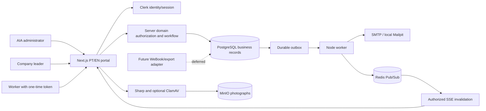

# AIA Accreditation Platform — Pre-Production Audit

Audit date: **12 October 2026** (Europe/Lisbon). Audited checkout: `00ef9a7`, including the existing uncommitted and untracked application changes. Scope: Version 1 collection and review of accreditation information **without WeBook**. This report is an audit, not approval to deploy or collect real personal information.

## A. Executive Summary

**Readiness: 4/10. Decision: NO-GO for production with real worker information.** A supervised internal pilot using synthetic data is reasonable. The application has a substantial, persisted external-company workflow, rather than simply mock screens. Its current security, privacy, operational recovery and several correction/change paths are insufficient for the requested production scope.

The web and worker production builds succeeded. TypeScript and source lint passed; **48 unit tests and 58 integration tests passed**. Targeted isolated-database probes nevertheless reproduced seven defects that those suites do not cover. The live Clerk browser suite also failed; details and the bounded follow-up are recorded in H. Passing builds and tests do not establish production readiness.

Most consequential results:

- A still-unused worker link can overwrite an already AIA-approved worker while the registration remains approved.
- A leader photo upload can overwrite approved and historical photo evidence before the server rejects the edit.
- A harmless SVG supplied as `image/jpeg` reached the image decoder; the installed Sharp version has a conditional upstream native-code vulnerability.
- Company deactivation is inconsistently enforced on direct reads, photos, mutations and employee links.
- Correction/resubmission and reopened-worker UI permissions disagree with the domain rules. Several declared exception categories are incomplete.
- Event configuration can invalidate previously approved worker details without final submission revalidation.
- Privacy notices are placeholders, retention/erasure is incomplete, and no viable tested backup/restore process is evidenced.
- The actual actor model has only ADMIN and COMPANY_LEADER. Internal AIA/Parkalgar imports and department-scoped access requested in this brief are absent.
- Checked-in infrastructure is local development infrastructure. Production Clerk, mail, TLS, runtime privileges, monitoring and recovery are not verified.

### Scoring criteria

This is a judgment-based readiness score, not a benchmark or compliance certification. Each dimension has equal weight. A score of 10 requires functioning core workflows, enforced boundaries, complete privacy safeguards, recoverable deployment and current execution evidence.

| Dimension | Score /10 | Basis |
|---|---:|---|
| Operational implementation | 6 | Real event/company/worker/review services, but corrections, exceptions and internal staff scope have material gaps. |
| Application security | 4 | Server-side RBAC, encrypted document numbers and tokens exist; locking and upload boundaries have concrete bypasses. |
| Technical privacy readiness | 2 | Event-specific records exist, but notice, retention, erasure and organizational decisions are unresolved. |
| Deployment and recovery | 2 | Local stack works; production provisioning, backups/restoration and delivery monitoring are missing/unproven. |
| Verification | 6 | Build, unit and integration evidence is current; browser failures and omitted security/concurrency scenarios limit confidence. |
| **Overall** | **4** | **Important launch blockers remain.** |

**Finding totals: P0 0; P1 18; P2 15; P3 1.** These count the distinct F01–F34 records, not every inventory row or dependency advisory. No arbitrary-person data leak, production compromise or native-code execution was demonstrated. Several P1 findings have serious integrity/security impact despite the absence of a demonstrated P0. Deferred integrations are excluded from these counts.

### Evidence and safety boundaries

- Source review covered routes, server actions, domain services, schema/migrations, worker/email/storage/configuration, tests and operator documentation. Findings apply to the current working tree, which already had application changes before this audit.
- Integration tests and seven targeted probes used the existing guarded loopback database **`aia_acreditacao_test` at port 16432**, with new synthetic fixtures. No reset, seed command, migration deployment, production connection or inspection of real personnel was performed. Existing fixtures leave synthetic rows in that test database.
- Storage integration used a dedicated synthetic audit bucket. Browser runs used test Clerk keys and synthetic accounts/fixtures; tests attempt provider-account cleanup. Local Mailpit captures synthetic mail. Cleanup of every synthetic DB/provider/storage artifact is not claimed.
- The separate audit build directory avoided replacing the PM2 web build. Build/browser tools regenerate `next-env.d.ts`; that generated-file side effect was restored to its clean pre-audit content. Automatic approval review rejected deletion of the generated audit build directory with “blocked by policy” and no more specific reason. The output was retained through a reversible rename to ignored `apps/web/.next-stale-audit-20261012`. The only additional visible source-tree artifact is this report. No application fix, dependency update or production service change is part of this audit.
- Live health responses are local evidence only. Production infrastructure, private-bucket policy, external mail deliverability, session revocation, restore, load and outage recovery were not certified.
- Historical memory was used to locate guidance, then checked against current source. Earlier test counts and the older `fva` claim were not reused as current evidence.

## B. Architecture Overview

### Actual stack and repository map

| Area | Actual implementation |
|---|---|
| Workspace | pnpm 10.14.0 monorepo; Node minimum 22.13.0; observed Node 22.17.0. Root `package.json:1-43`. |
| Web | Next.js 16.3.6 App Router, React/React DOM 19.3.0, TypeScript ~5.9.3, next-intl 4.14.6, Clerk Next 7.9.4. `apps/web/package.json:1-65`. |
| UI | Tailwind, global CSS, Radix primitives, MUI date controls, Recharts, motion, multiple icon families and custom modals. This is a working operational interface, with substantial bespoke component code. |
| Domain | `packages/domain/src`: auth, events, companies/registrations, participants, submissions/reviews/photos, requests, vehicle passes, zones, job roles, audit, notifications and portal queries. |
| Database | PostgreSQL 17 locally; Prisma CLI/client/adapter 7.10.0; `pg`; 14 checked-in migrations. Schema at `packages/database/prisma/schema.prisma`. |
| Worker | Node process bundled by esbuild, timer-driven outbox consumers and reminders; **not BullMQ**, despite the original design suggestion. `apps/worker/src/main.ts:1-54`. |
| Email | Nodemailer 10.0.10 SMTP adapter, React Email templates, encrypted authentication/invitation payloads, durable EmailDelivery records. SMTP/Mailpit now; Resend future; no Postmark. |
| Storage | AWS S3 SDK against private-intended MinIO; Sharp 0.35.4 image re-encoding; optional ClamAV. `packages/storage/src/index.ts:1-94`. |
| Redis | ioredis 6; token-based public rate limits and Pub/Sub invalidations. Redis is not business-record storage. |
| Local operation | Docker Compose backing services, Windows PowerShell lifecycle, PM2 web and worker. No production app Dockerfile, reverse-proxy release configuration or CI deployment workflow found. |
| Tests | Vitest unit/integration; Playwright no-auth and live test-Clerk projects. Integration and browser database guards require loopback and the specific test database name. |

Identity is derived from Clerk's server SDK. Internal user mapping and company memberships in PostgreSQL determine authorization. `requirePortal` and domain checks are present; middleware alone is not the protection boundary. Every administrator currently has broad access. Leaders hold persistent company memberships, not independent event entitlements.

Important mutations use serializable transactions with up to two retries for Prisma P2034 (`shared/transaction.ts:5-14`). Registration/event/request/vehicle operations generally use optimistic version checks. Participants increment versions but do not accept stale-screen expected versions. Database commit, object storage and SMTP are separate consistency boundaries; problems at those boundaries are central findings here.

Company submissions contain encrypted, versioned snapshots plus per-person reviews and append-oriented decisions. Historical photographs are not fully immutable: snapshots reference a mutable profile key and photo access can fall back to the current participant record. Audit records use a minimal metadata allowlist. Notifications/outbox intents are generally created within the business transaction.

### Model boundaries

`Company` and leader membership are reusable. `CompanyEventRegistration` is unique per company/event. `EventParticipant` is event-specific and has a composite registration/event FK. Zones are global catalog entries activated per event, then requested company-wide. Work days belong to each participant. Vehicle passes hold quantities and justification, without number plates or driver identities.

There is no internal employee master record, department hierarchy, HR role, department-head permission, import job, barcode pool, external mapping or synchronization model. QR, WeBook, Matica and scanning remain deferred. Internal staff and department permissions are separate requested V1 scope gaps, not automatically part of that deferral.

### Source and route coverage

The discovered route families are: landing/access/portal, sign-in/sign-up/security, invitation start/accept, worker onboarding/completion, company list/registration/participant/submission/requests/notifications, and admin overview/setup/companies/people/credentials/submissions/queue/requests/vehicles/audit/notifications. API routes cover liveness/readiness, Clerk webhook, invitation start, notifications read/all-read, SSE, participant photos, review photo derivatives and event banners. The production build enumerated these real routes; that establishes routing/build presence only.

Custom modal/form sources reviewed include participant profile/fields, add-worker/share-link, photo crop, admin person review/photo adjustment/final decision, submission summary, destructive confirmation, company requests, event setup and dates, and notifications. Full visual/keyboard verification of every modal and PT/EN route was not completed. Sections C, D and H identify narrower execution evidence.

### Complexity and abandoned assumptions

The modular monolith is appropriate; no architectural rewrite is justified by this audit. Main debt is inconsistent policy duplication between server services and UI, mutable file references, manual client DTO construction, and evolving docs. Multiple UI/icon/style systems add maintenance cost, but are not launch blockers by themselves. `README.md` still says submission transitions are not exposed, although they are. The handoff describes future BullMQ/Sentry/export/retention work that is not shipped. Those descriptions must not be counted as implemented services.

## C. Feature Inventory

Status meanings: **Complete and verified** means the specifically described behavior was exercised in this audit, at the stated layer; it does not certify production infrastructure. **Implemented but unverified** means a traceable implementation exists without sufficient current execution. **Partially implemented**, **UI only / mock functionality**, **Broken**, **Missing**, and **Intentionally deferred** are used literally. Priority `—` denotes no independent issue established; references to F findings use their canonical severity.

### Events, companies and access configuration

| Feature | Status | Evidence | Missing/Issue | Priority |
|---|---|---|---|---|
| Create event with calendar dates, onboarding instants, timezone | Complete and verified | `events/service.ts:10-36`; foundation integration; browser setup case passed | Production event not created; final review checks incomplete | F12 P1 |
| Edit event with version conflict protection | Complete and verified | `events/service.ts:39-59`; foundation/concurrency tests | Existing worker data not revalidated after schedule changes | F12 P1 |
| Setup wizard persists event/catalogue/company records | Complete and verified | `admin/setup/setup-view.tsx:50-102`; browser setup passed | All visual steps/layouts not certified | — |
| Publish draft event | Complete and verified | `events/lifecycle.ts:19-38`; setup actions; unit/browser setup | No persistent publication-history record beyond audit | — |
| Deadline/active/completed derived lifecycle | Complete and verified | lifecycle unit tests; `effectiveEventStatus` | Some UI/date and reminder paths disagree | F10 P1 / F23 P2 |
| Event archival operation | Missing | ARCHIVED enum exists; create/update accepts DRAFT/PUBLISHED only | No exposed archive service/action; event completion is not erasure | F07 P1 |
| Duplicate event | Missing | No duplication service/action | Optional convenience, not independently launch-critical | P2 scope option |
| Delete event | Missing | No event deletion service; restrictive FKs | Define archive/retention first; do not improvise cascading deletion | F07 P1 |
| Global zones CRUD/activation | Complete and verified | `zones/service.ts`; foundation tests and setup UI | Deactivation is blocked when requested; no independent defect established in that guard | — |
| Event-specific zone activation | Complete and verified | `EventZone`; configureRegistration tests | Snapshot submission does not revalidate current activity | F12 P1 |
| Global roles CRUD/activation | Complete and verified | `job-roles/service.ts`; foundation tests | Reused names; role deactivation does not revalidate approved workers | F12 P1 |
| Company create/edit/deactivate | Partially implemented | `companies/service.ts:10-35`; tests | Deactivation fails to suspend several direct paths | F03 P1 |
| Company/event registration uniqueness | Complete and verified | schema `:209-228`; constraints integration | Current leader membership is broader than event assignment | F13 P1 |
| Invite leader by SMTP-backed email | Complete and verified | `auth/invitations.ts:41-79`; local SMTP/invitation tests | Production sender/provider delivery unverified | F14 P1 |
| Existing account accepts matching verified-email invitation | Complete and verified locally | invitations integration and targeted browser acceptance passed | Production restrictions/settings unverified | F14 P1 |
| New leader account creation through Clerk invitation ticket | Complete and verified for ticket/form opening | browser sign-up cases passed; `api/invitations/start/route.ts` | Creating/rendering a ticket is not complete external onboarding/delivery proof | F14 P1 |
| Expired, reused, revoked, wrong-recipient leader invite denial | Complete and verified at domain layer | invitations tests; hashes and transaction guards | Provider account/ticket lifecycle still needs production verification | — |
| Multiple leaders and primary responsible leader | Implemented but unverified as full UI workflow | schema memberships; invitations `:115-135`; registration service | New invite does not silently replace primary leader | — |
| Primary leader reassignment/membership revocation | Missing supported operator workflow | Existing primary set only when null; schema supports revokedAt | Replacement invitation leaves original primary/rights; unused-invite revocation is a different operation | F13 P1 |
| Company profile onboarding | Partially implemented | company registration portal and invitation association | Company model primarily name/status; no broader supplier master onboarding | P2 scope confirmation |
| Headcount declaration distinct from formal limit | Missing | personnelLimit exists, no separate declaration field | Confirm whether formal limit is sufficient for V1 | P2 scope confirmation |
| Personnel limit edit and extra-slot exception | Complete and verified at domain layer | registration/request integration; capacity tests | Admin can set below existing active count; limit is not a DB aggregate constraint | F12 P1 |
| Leader company-wide zone selection | Complete and verified | browser configuration passed; registration service `:48-90` | Company-wide requests, not individual worker access-zone assignment | — |
| Vehicle quantity/justification requests and independent decision | Complete and verified | vehicle integration; browser separate vehicle decision passed | Physical passes not issued | — |
| Reuse one company across events | Complete and verified at relationship/access-test layer | unique registration and authorization fixtures | Event-specific data exists; leader visibility remains company-wide | F13 P1 |

### Workers and submissions

| Feature | Status | Evidence | Missing/Issue | Priority |
|---|---|---|---|---|
| Atomic empty worker slot + employee link | Complete and verified at domain layer | onboarding integration | Failed/abandoned slots consume capacity until removal | — |
| Leader manual worker entry | Complete and verified for ordinary entry/approval | `participants/service.ts:233-279`; integration and follow-up browser case | Stale worker writes allowed; reopen/retired paths have separate gaps | F20 P2 |
| Meaningful draft save / empty-draft removal | Complete and verified at domain layer | onboarding integration | Draft-saving Back action is reused for non-draft workers | F10 P1 |
| Public one-time worker submission | Partially implemented | token/hash/validation integration | Stale unused token bypasses registration lock | F01 P1 |
| Used/expired/revoked worker-token denial | Complete and verified at domain layer | onboarding integration | Does not cover unused token after leader completion/approval | F01 P1 |
| Worker cannot retrieve other workers' PII from public form | Complete and verified at domain view/test layer | employeeInvitationView only returns event/company/form context | Valid bearer link can change its own target beyond allowed state | F01 P1 |
| Photograph crop and JPEG storage | Partially implemented | storage and processing tests; client crop/server Sharp | Pre-authorization writes, mutable history and decoder format gap | F02/F04 P1 |
| Authenticated photograph retrieval | Partially implemented | photoAccess membership tests; route auth | Inactive company access not blocked; bucket policy not verified | F03/F14 P1 |
| Identity types: passport/citizen/residence card | Complete and verified at validation layer | `participants/identity.ts`; participant tests | No ID document image upload feature; numbers only | — |
| Document valid through full event | Complete and verified at entry/leader approval layer | identity/onboarding tests | Later event changes are not revalidated at company submission | F12 P1 |
| Event-scoped normalized duplicate detection/review | Partially implemented | HMAC and duplicates tests; indexed event fingerprint | Changing type without number keeps stale fingerprint | F19 P2 |
| Explicit admin duplicate override | Complete and verified at domain layer | onboarding integration; queue action | Operator must understand duplicate decision; no arbitrary unique-number DB constraint | — |
| Phone E.164 / ISO nationality / DOB / required fields | Complete and verified at entry-validation layer | phone/calendar/onboarding tests | Required-field completeness not enforced at final submission boundary | F12 P1 |
| Individual work days within event | Complete and verified at entry layer | onboarding tests | Exception changes can preserve prior approval | F09 P1 |
| Worker job role assignment | Complete and verified at domain layer | role lookup/worker tests | No department assignment | F13 P1 |
| Worker edit before submission | Partially implemented | leader mutation service | UI locks LEADER_APPROVED workers even after reopen | F10 P1 |
| Soft remove / link revocation / capacity release | Complete and verified at domain layer | onboarding/request tests | Preserves personal data; not privacy erasure | F07 P1 |
| Admin permanent worker deletion | Broken for complete historical erasure | deletion integration only draft records; source `admin/permanent-deletion.ts:11-28` | Historical snapshot retained, adjustment trigger conflicts, approval not invalidated | F07/F08/F09 P1 |
| CSV/Excel worker import | Missing | No importer route/service/parser/job | Requested internal staff workflow absent | F13 P1 |
| Internal AIA/Parkalgar staff management/import | Missing | No internal staff or department model | Generic contractor company is not an internal HR workflow | F13 P1 |
| Company final submission / encrypted snapshot version | Partially implemented | final-submission integration; probe incomplete worker accepted | Status-based readiness can accept stale/incomplete content | F12 P1 |
| AIA individual person review | Complete and verified at domain layer | final-submission tests; per-person reviews | Domain and full browser coverage differ | — |
| Final approval | Complete and verified at domain decision layer | final-submission tests and synthetic approval probe | Approved record can be changed through other paths | F01/F02/F09 P1 |
| Rejection / mandatory reason/comment | Complete and verified at domain layer | state machine and final-submission tests | REJECTED is terminal; no normal leader resubmission unless policy changed | — |
| Return selected people with correction instructions | Complete and verified at domain layer | final-submission tests | Full post-deadline browser cycle fails UI eligibility rules | F10 P1 |
| Correct and resubmit after deadline | Broken in UI for ordinary returned correction | submission page `:26-28` versus service `:109-111` | Requires emergency request in UI although domain accepts return | F10 P1 |
| Reopen approved registration / invalidate prior approval | Complete and verified at domain layer | service `:204-220`; final-submission tests | Reopened worker edit controls remain locked | F10 P1 |
| Registration optimistic concurrency / simultaneous reviews | Complete and verified in existing integration scenarios | registration-concurrency/final-submission tests | Upload storage and per-worker stale-screen writes excluded | F02 P1 / F20 P2 |
| Immutable historical personal-data snapshot | Complete and verified for DB snapshot writes | snapshot tests and delete/update trigger | Photo evidence not immutable; retention erasure conflicts | F02/F07 P1 |
| Versioned worker/privacy acknowledgement | Partially implemented | stored fields and final declaration | TODO text, client-controlled versions, wrong event wording | F06 P1 |

### Requests, administration and supporting systems

| Feature | Status | Evidence | Missing/Issue | Priority |
|---|---|---|---|---|
| Create request / review / approve / reject / cancel | Complete and verified for tested categories at domain layer | requests integration | Not every declared category is executable or shown in UI | F11 P1 |
| Extra personnel | Complete and verified at domain layer | request limit tests | Browser request flow failed before approval due notification read assertion | F24 P2 |
| Urgent replacement, linked new draft, rereview | Complete and verified at domain layer | requests integration | Full external post-deadline completion/delivery not certified | — |
| Zone-change request | Complete and verified at domain layer | request-zone integration | Policy is company-wide; no individual zone grants | — |
| Vehicle-change request | Complete and verified at domain layer | requests/vehicle tests | Clears/reviews vehicle request independently | — |
| OTHER request | Complete and verified as recorded decision | service `:115` | Approval records decision but performs no data change | P2 scope clarification |
| EDIT_PERSON / REPLACE_PHOTO | Broken at approval; unavailable in UI | targeted probes; request schema `:18-20`, apply effect falls through | Creation succeeds; approval INVALID_INPUT and remains pending | F11 P1 |
| ADD_AFTER_DEADLINE | Broken completion path; unavailable in UI | targeted probe | Approved new draft cannot be filled after deadline | F11 P1 |
| REMOVE_AFTER_DEADLINE / CHANGE_WORK_DAYS | Partially implemented | domain effect branches; no composer controls | Changed days can leave registration APPROVED | F09/F11 P1 |
| Request audit and durable notifications | Complete and verified at domain layer | transactional/request/business-notification tests | Does not prove delivery/recovery after final retry exhaustion | F17 P1 |
| Real event dashboard counts / company zone chart | Complete and verified for tested fixture | browser dashboard/event/zone assertions; onboarding totals test | No invented benchmark; some rows/counts represent different statuses | F21 P2 |
| Action-required queue | Partially implemented | real pending submissions/requests/duplicates | UI routes/tests disagree on request-row location | F24/F32 P2 |
| Company/worker/submission/vehicle tables and detail pages | Implemented but unverified for every state | operations-view and domain query trace; browser selected pages | Search/filter in memory, no scalable pagination | F21 P2 |
| Credentials page | Intentionally deferred for issuing cards | Actual page explicitly says approval does not issue a credential | Read-only approved-record view; no fake issuance | DEFERRED |
| Account and security page | Implemented but unverified for expiry/revocation | Clerk component/server session | Production account settings not inspected | F14 P1 |
| Staff account/role management | Partially implemented | controlled bootstrap CLI; disabledAt/membership fields | No department-head role or full user-admin UI | F13 P1 |
| Admin audit list | Partially implemented | persistent audit events, latest 100 query | No pagination, full actor/detail UI or personal-data-read audit | F26 P2 |
| Notification history/read/all-read | Partially implemented | domain read tests; browser read assertion failed | Latest 30 only, stale local counts, silent client failure | F24 P2 |
| Global application settings | Missing beyond environment/catalogues | No settings model/UI | Retention/notices/provider controls are deployment/policy gaps | F06/F07/F14 P1 |
| PT/EN routes/messages | Partially implemented | both catalogs and templates; English browser suite | Complete Portuguese flows not executed; hardcoded English summaries | F32 P2 |
| Mobile worker/leader layouts | Implemented but unverified comprehensively | CSS breakpoints; limited 390px tests in suite | Test name alone does not establish mobile worker QA | F30 P2 |
| Worker/business mail actually dispatched | Complete and verified to local Mailpit in integration scenarios | smtp/auth/invitation/business-notification tests | Production delivery, bounce handling and final-failure recovery unverified | F14/F17 P1 |
| Realtime invalidation / SSE authorized refetch | Partially implemented | outbox integration and source | Missed messages on reconnect, global fan-out | F25 P2 |
| Health/start/restart/shutdown | Complete and verified for current local HTTP health | four local API responses 200; scripts inspected | Startup and readiness do not certify recovery or production suitability | F16 P1 / F28 P2 |
| Retention / legal hold / rights erasure | Missing/incomplete | no job/config; destructive deletion conflicts | Manual or automated approved process required | F07/F08 P1 |
| Backups/restoration/production rollback | Missing evidence and automation | local-only deployment docs | No recovery guarantee for collected data | F15/F16 P1 |
| WeBook export / QR/barcode pool / import reconciliation | Intentionally deferred | docs/EXPORTS and schema absence | Specifications pending meeting | DEFERRED |
| Matica card-print / scanner integration | Intentionally deferred | stated V1 scope | Not needed to collect/review data | DEFERRED |

Inventory gaps described as optional scope confirmations are not additional numbered findings. No major core feature was classified as UI-only simply because production is not configured. Conversely, a declared enum does not establish an executable workflow.

## D. End-to-End Workflow Results

### A — AIA creates an event

Inspected setup server actions, wizard, event/zone/role services and FK relationships. Foundation integration and browser setup/selected-event tests exercised real persistence and navigation. Creation, publishing, selected-event dashboard context and company-zone chart assertions passed. No production MotoGP event was created. Event-date/role/zone changes after worker approval remain unsafe without final revalidation (F12). Event duplication, archival and deletion operations are absent; derived COMPLETED is not archival or retention.

### B — Company onboarding

Inspected company/registration/invitation actions, Clerk ticket generation, verified-email matching and membership assignment. Domain integration verified matching acceptance, token expiry/reuse/revocation, transactional mapping and company association. Browser tests verified direct sign-up denial, valid invitation opening the Clerk account form, admin and leader login/access; a separate targeted run verified matching invitation acceptance, expiry and revocation. Creating the account form is not evidence that every invited new user completed account creation and received production email. Persistent memberships grant access across company events; primary-leader replacement does not revoke other memberships. Production Clerk invite-only settings, SMTP and stale-account/session revocation remain unverified.

### C — Worker collection

Inspected both manual and bearer-token entry, field validation, image crop/server processing, storage and duplicate review. Integration tested capacity, token use, form validation, full-event document validity, phone normalization, encrypted numbers, duplicate review and private-intended object round-trip. The follow-up browser run also passed manual entry/approval, public worker submission/token reuse denial, drafts, link creation and narrow mobile/confirmation checks. The targeted probe completed a worker manually, obtained actual domain AIA approval, then submitted through its original unused link: **worker identity changed, worker became AWAITING_LEADER_REVIEW, registration stayed APPROVED**. F01 is dynamically reproduced against the test DB. Harmless SVG spoofing was accepted by the decoder. F02's upload-before-lock behavior is source-proven, not a live crafted-action exploit. See H for browser execution boundaries. Anonymous bucket privacy, malformed native-image crash cases, metadata inspection of real photos and concurrent storage writes were not exercised.

### D — Company submission and review

Integration exercised encrypted versions, latest-submission checks, person review, approval/return/rejection, required reasons and optimistic conflicts. Synthetic audit approval also passed. A separate probe placed an empty worker in LEADER_APPROVED state in the isolated DB and the final submit service accepted it. That setup demonstrates insufficient boundary validation, not an arbitrary caller's ability to directly set DB state. A realistic trigger is admin extension of an event or catalog deactivation after approval. Photo writes and old employee tokens can independently mutate the live approved data. Production end-to-end email notification receipt is unverified.

### E — Corrections and resubmissions

Inspected selected-person return notes, leader edit policy, final resubmission and audit/outbox records. Existing integration tests passed domain correction/resubmission scenarios. Full browser correction/resubmission was not established. Source shows ordinary post-deadline returned corrections can be saved in the domain but cannot be submitted by the page unless an approved request also exists. Back/Cancel tries draft-saving for non-draft workers. A return for company configuration rather than a person needs its own usable post-deadline permission. F10 requires an entire correction cycle retest, including leader notification and mandatory instructions.

### F — Approved submissions and later changes

Domain tests exercised reopen/invalidation, replacement and extra personnel. Targeted probes reproduced unsupported edit/photo request approval, locked drafts after approved ADD_AFTER_DEADLINE, and changed work days with APPROVED retained and **zero APPROVAL_INVALIDATED reviews**. Company deletion with a prior submission rolled back on SUBMISSION_IMMUTABLE. Direct participant deletion can retain approved registration status and snapshot PII. UI refuses editing LEADER_APPROVED workers after reopen. AIA must agree whether a request decision itself is a separate valid approval or all changed content must form a new reviewed version; current mixed behavior is not a consistent approval model.

### G — Internal staff import

Searched routes, domain packages, dependencies and schema for CSV/Excel ingestion, column mappings, import batches, internal personnel and departments. **Missing; no sample import was possible.** No fake successful import is claimed. AIA/Parkalgar staff could only be represented through generic company registrations/manual entry under the existing model; that does not satisfy the requested import and department-access workflow. F13 is a scope gate unless AIA explicitly revises V1.

### H — Multiple companies and events

Authorization/integrity tests use multiple isolated companies and check denied membership, disabled users, revoked memberships and inconsistent event/registration foreign keys. Browser leader listing showed only its authorized company; the targeted browser test denied opening another company's registration. Full same-company/different-event and department-scoped browser verification is incomplete. Workers are event-specific, but company membership intentionally permits all that company's registrations. Direct access after company deactivation is inconsistent. Navigation always selects the first accessible registration for leader sidebar links; a leader working another company/event can be redirected to that first registration (F31). No department isolation can be verified because it is not implemented.

## E. Security Findings

Source-reference convention: abbreviated domain paths below are relative to `packages/domain/src`; component names are relative to `apps/web/src/components`; migration paths are relative to `packages/database/prisma/migrations`. Line numbers refer to the audited working tree and can move after fixes.

### F01 — P1 — Unused worker links bypass review/approval locks

**References:** `packages/domain/src/participants/service.ts:98-112,127-160,233-279` (`employeeInvitationView`, `submitEmployeeOnboarding`, leader update/approval).

Token expiry, use/revocation and event publication/dates are checked, but registration and participant edit states are not. Manual leader completion and leader approval leave an earlier unused token active. A bearer can overwrite identity, dates and photo even after AIA approval. The live registration approval remains, while the worker becomes awaiting leader review. This undermines the meaning of approval and permits a stale capability to modify locked information.

**Verification/confidence:** high; actual domain flow reproduced with new synthetic test-DB records, including manual completion, final submission and AIA approval before reuse. No other person's data was accessed.

**Remediation:** enforce current participant/registration edit policy inside token consumption; revoke obsolete employee links when manual leader entry supersedes them and at submission lock. Test submitted, approved, removed/replaced and correction states plus races between manual/public completion. Revocation alone without transactional state checks is insufficient.

### F02 — P1 — Upload-before-lock and mutable object keys invalidate photo evidence

**References:** participant actions `apps/web/src/app/[locale]/company/[registrationId]/participants/[participantId]/actions.ts:26-56`; public onboarding actions `apps/web/src/app/[locale]/onboarding/[token]/actions.ts:15-37`; `apps/web/src/server/participant-photo.ts:6-24`; `packages/domain/src/submissions/photo-adjustments.ts:38-50`.

Leader read authorization runs first, then the action writes the deterministic `photos/.../profile.jpg`, then the domain edit check runs. A legitimate leader can craft a save for an approved/submitted worker; the storage write succeeds even though the database rejects EDIT_LOCKED. Public upload similarly precedes input/privacy/token consumption checks. Invalid submissions can leave objects; competing requests can overwrite the eventual winning photo. Snapshots refer to that mutable key; historical-photo GET falls back to the current participant key rather than that version's immutable evidence.

**Verification/confidence:** high source proof. The isolated tests exercise storage and DB policy separately; an actual crafted locked-photo HTTP request was not executed. No race exploit was run.

**Remediation:** authorize before expensive processing, stage under unique immutable keys, attach the key only in a transaction that rechecks state/version, and durably clean rejected staging objects. Bind each snapshot to immutable photo bytes/key. Preserve original plus explicit reviewed derivative when adjustments are needed. Preflight authorization without immutable objects and a final concurrency guard does not fix the race.

### F03 — P1 — Company deactivation does not consistently suspend direct access

**References:** `companies/service.ts:21-35`; `auth/authorization.ts:18-21`; `portal/queries.ts:42,114-117,151-164,190-195`; participant token flow `participants/service.ts:127-160`.

Company listings and leader registration reads omit inactive companies; new leader invitations reject them. `requireCompany` only checks membership/revocation. Direct participant/photo reads and mutations can still use an active membership; public worker links ignore company deactivation. Hiding the company is not a server-side suspension boundary.

**Verification/confidence:** high; actual `participantPhotoAccess` invoked with an in-memory synthetic inactive-company/membership mock returned a photo key. No storage or real DB read in that check.

**Remediation:** define suspension semantics and enforce them in central authorization and bearer-token consumption. Revoke outstanding capabilities as appropriate. Keep administrator historical access explicit. Company-wide historical read permissions need separate AIA confirmation.

### F04 — P1 — Reachable decoder format mismatch and unpatched production dependencies

**References:** `packages/storage/src/index.ts:40-62`; `packages/storage/package.json` (Sharp); `apps/web/package.json` (Next); `pnpm-lock.yaml`; `apps/web/next.config.ts:14-23`.

The accepted MIME string comes from the caller. Sharp auto-detects content; code checks dimensions but never checks decoded format against the permitted raster formats. A harmless 110-byte SVG sent as `image/jpeg` was accepted and returned a 324-byte JPEG. Re-encoding strips metadata/output active content, but it happens **after** a potentially unsafe decoder processes the original input.

The production dependency audit returned **8 advisories: 3 high, 4 moderate, 1 low, 0 critical** across Sharp, Next and source-map-js. Sharp 0.35.4 is affected by the maintainer's [librsvg vulnerability advisory](https://github.com/lovell/sharp/security/advisories/GHSA-wq5f-xc86-pv6w), patched in 0.35.5. Its native execution impact depends on Linux/runtime conditions. The SVG decoder is reachable here; **RCE was not demonstrated**, and this Windows audit does not establish exploitation on a future Linux VPS.

| Advisory | Dependency/result | Repository applicability |
|---|---|---|
| GHSA-wq5f-xc86-pv6w | Sharp high; registry patch >=0.35.5 | Spoofed SVG reaches decoder; Linux native conditions untested. |
| GHSA-68fv-2mgg-jv7q | source-map-js 1.2.1 high; registry patch >=1.2.2 | Under Next/PostCSS; no application path accepting attacker-supplied source maps was identified. |
| GHSA-cjq9-62q9-8jv4 | Next high, remote image SSRF | No images.remotePatterns configured; maintainer [states that configuration is unaffected](https://github.com/vercel/next.js/security/advisories/GHSA-cjq9-62q9-8jv4). |
| GHSA-3w37-wq28-93x7 | Next moderate, Draft Mode cache-fill leak | Cache Components/useCache and Draft Mode not found enabled. |
| GHSA-4jqv-mc3x-m676 | Next moderate, Pages Router SSG/ISR poisoning | Application uses App Router, not the affected Pages Router setup. |
| GHSA-f87g-xv8r-7p7x | Next moderate, webpack metadata-image route bypass | Turbopack build; affected metadata image routes not found. |
| GHSA-mcj8-r9mp-w47p | Next moderate, root catch-all SSG/ISR cache poisoning | Affected root catch-all page not found. |
| GHSA-39w2-rjm5-chcv | Next low, development MCP disclosure | Development-server concern; production next start does not serve it. |

The registry recommended Next >=16.3.8. Maintainer pages and registry patch metadata can differ; select verified maintained patched releases when fixes are authorized. Advisory severity is not automatically this application's severity.

**Verification/confidence:** high on installed/locked versions and harmless SVG acceptance; conditional on native advisory exploitability. No malicious SVG, source-map DoS, SSRF or external exploit attempted.

**Remediation:** patch affected production dependencies without a wholesale dependency rewrite; reject SVG/other unapproved decoded formats, preferably disable unused native decoders before parsing. Validate both detected format and dimensions. Repeat build/tests and targeted benign MIME-mismatch checks on the actual production image.

### F05 — P1 — Aggregate upload and public-request resource limits are insufficient

**References:** `apps/web/next.config.ts:22`; `packages/storage/src/index.ts:41-49`; `participant-photo.ts:15-20`; `apps/web/src/server/rate-limit.ts:10-16`; public onboarding page/actions; invitation start POST.

Server actions accept 151 MB; photos accept 150 MiB and are buffered/processed in the web process. Browser cropping normally shrinks uploads but is bypassable. Limits are primarily per token; arbitrary distinct invalid tokens get distinct Redis keys before validation. No app-level ingress IP/global rate bound or processing concurrency cap was found. Repeated invitation-ticket creation also lacks an application throttle.

**Impact:** many simultaneous uploads or distinct token requests can consume memory, native CPU, DB work and Redis keys. No safe near-deadline load evidence bounds that risk.

**Verification/confidence:** high source confidence, unmeasured outage risk. No resource-exhaustion test performed.

**Remediation:** smaller server-side processed-photo ceiling, proxy/body limits before parsing, bounded image-processing concurrency and IP/global safeguards alongside token limits; provider invitation throttling. Follow the [OWASP upload guidance](https://cheatsheetseries.owasp.org/cheatsheets/File_Upload_Cheat_Sheet.html) on format checks, limits and storage controls. Benchmark synthetic concurrent small uploads on the release candidate.

### Authorization/security coverage that did not reveal a new vulnerability

- Server-side DB role/membership checks, disabled users, revoked memberships, cross-company denials and admin-only decisions have integration coverage. No guest-admin fallback exists. ADMIN authorization is broad by design; no department protection can be claimed.
- Leader invitations use 256-bit random tokens, hash-at-rest, expiry, verified-email matching and transactional consumption. Existing membership persists across company events. A valid worker link gives a limited bearer capability, not authenticated worker account access.
- Strict Zod allowlists are common. No interpolated raw SQL input, dangerous HTML insertion, arbitrary external redirect or broad application CORS was identified in examined runtime code. This is not an exhaustive proof of absence.
- Notification POST routes compare Origin and require a mapped session; server actions use Next's origin gate. Clerk test contexts can emit unusual Origin values; notification browser failure root cause is unresolved. Do not weaken CSRF to make tests pass.
- Clerk webhook verifies signatures, bounds streamed body size to 1 MB and restricts events. Signature/bad-request integration passed. Actual production webhook endpoint delivery is unverified.
- GET photo routes authorize each request and use private/no-store. Keys derive from server UUIDs, avoiding user-filename traversal. No presigned/public URL flow exists; signed-URL expiry is therefore not a current feature to verify.
- Sharp re-encodes JPEG with pixel limits and orientation handling, normally strips metadata. ClamAV fails closed when configured; absent host deliberately disables scanning. Live malware scanning was not tested.
- Proxy sets no-referrer, nosniff, deny-framing and private/no-store. No CSP or app-level HSTS deployment evidence; HTTPS/proxy security is part of F14. Clerk/script compatibility must be considered before adding CSP.
- `.env` is ignored and only `.env.example` is tracked. No production secret values are reproduced here. No comprehensive Git-history secret scan or client-bundle secret scan was performed. Config/manifests do not justify a claim of leaked production credentials.
- Admin bootstrap verifies email, invitation acceptance requires verified matching email, and session uses Clerk SDK plus DB mapping (`session.ts:11-17`). Current code has no `fva` check. MFA was explicitly removed by a prior decision in the handoff; absence of MFA is not classified as an unauthorized implementation defect. Production expiry/revocation/recent-verification policy still needs confirmation.

These findings align with object/state authorization concerns in [OWASP API1:2023](https://api-security.owasp.org/editions/2023/en/0xa1-broken-object-level-authorization/). F01/F02 are specifically state/capability integrity failures, not a demonstrated arbitrary cross-company IDOR.

## F. GDPR and Privacy Findings

### Data inventory and minimization

Worker collection includes full name, date of birth, identity type/number/expiry, mobile, nationality, job role, work days, mandatory photograph and privacy acknowledgement/version/time. Company information is primarily name/status; leaders use Clerk identity/email and company memberships. Vehicle requests deliberately avoid plates/drivers. No address, gender or identity-document scan upload was found.

Document numbers use AES-256-GCM bound to participant ID, a separate HMAC duplicate fingerprint and last-three display (`participants/identity.ts:16-48`). Snapshots encrypt the entire serialized submission bound to submission ID. Mutable name/DOB/mobile/nationality rows are not field-encrypted. Photos are private-intended objects, not encrypted by application code. Disk/backups/TLS encryption remain deployment controls.

Snapshots duplicate worker details per version; company leaders can see workers across their company events. Event-specific rows avoid automatic cross-event person reuse, but they do not impose expiry. Names in notices, notifications and mail are also personal/contextual information. Mail minimizes worker detail and generally targets leaders/admins, not individual workers, but SMTP and Clerk are processors needing organizational assessment.

AIA must establish necessity of every requested field for this initial no-WeBook version. The handoff labels some fields as external pass requirements, but final WeBook specifications remain unknown. Do not remove required fields blindly, and do not use hypothetical future integration as the only minimization justification.

### F06 — P1 — Placeholder/wrong-event notice and unsupported consent/compliance claims

**References:** `participant-fields.tsx:65`; i18n `messages.ts:207-209,256,528-530,577`; company submission page `:85`; submission/participant input schemas.

Workers see TODO privacy text and acknowledge `TODO-v1`. Final company text literally says MotoGP 2026 for every event; passing `{event}` does not interpolate because the translations contain no placeholder. The text asserts consent and GDPR conformity; the repository has no approved basis/notice evidence. Client-controlled notice-version strings are accepted without binding to approved text.

**Impact:** AIA cannot show what valid approved event-specific notice was given or use the stored checkbox as proof of a suitable lawful basis.

**Verification/confidence:** high source evidence in both PT/EN catalogs; current browser notice content coverage is limited. No legal determination that a particular lawful basis is required is made.

**Remediation:** AIA-approved bilingual worker notice and leader declaration; server-owned version registry tied to text/event purpose and timestamp; remove unsupported blanket compliance assertions. A company leader's checkbox does not automatically provide workers' valid consent. The [EDPB lawful-processing guidance](https://www.edpb.europa.eu/sme/be-compliant/process-personal-data-lawfully_en) specifically cautions about freely given employee consent. AIA must choose and document the appropriate basis for each actor/purpose.

### F07 — P1 — Retention and full erasure across copies/storage are not operational

**References:** `docs/OPEN-QUESTIONS.md:9`; `docs/ARCHITECTURE.md:34`; schema `EventParticipant/CompanySubmission`; submission snapshot fields `submissions/service.ts:59-79`; destructive action `admin/destructive-actions.ts:13-31`.

No retention configuration/job, legal-hold workflow, expired-record purge or backup expiry evidence exists. Completed/archived events do not delete PII. Participant deletion leaves decryptable historical snapshot copies. Object deletion is post-commit; allSettled results are ignored and errors swallowed. The UI can report deleted while MinIO retains an orphan photo. Failed/staged uploads and old derivatives are also unaccounted for.

**Verification/confidence:** high source evidence; actual failed-storage erasure was not induced. Snapshot retention is deliberate implementation, but cannot be treated as an approved indefinite retention policy.

**Remediation:** inventory all copies; approved retention/holds; durable deletion manifest/outbox, retries, verification and honest pending/failed status; controlled snapshot redaction/erasure strategy preserving minimal permitted audit metadata. A tested, accountable manual process can satisfy an initial operational gate if realistic; automation is not the only acceptable approach. Do not adopt the handoff's proposed date offsets as approved policy.

### F08 — P1 — Advertised permanent deletion conflicts with DB immutability

**References:** `admin/permanent-deletion.ts:23-27,55-66`; migrations `20260924000200_submission_immutability/migration.sql:9-19` and `20260926000100_submission_photo_adjustments/migration.sql:21-22`; deletion tests `:10-49`.

The deletion service attempts to delete append-only snapshots/reviews/adjustments that DB triggers prohibit deleting. A non-approved company with any prior submission cannot complete this deletion path. A participant with immutable photo adjustments can also fail. Existing tests exercise drafts without submitted history.

**Impact:** rejected/returned submissions cannot be erased through the advertised workflow. Trigger protection prevents uncontrolled destruction, but the service promises an outcome it cannot achieve.

**Verification/confidence:** high; submitted-company deletion reproduced and transaction rolled back with SUBMISSION_IMMUTABLE; company retained. Adjustment-delete conflict is source-proven only.

**Remediation:** separate normal business removal from exceptional authorized privacy erasure. Design a restricted, auditable retention purge with explicit privilege and tested trigger semantics. Do not simply disable immutability triggers globally.

### F26 — P2 — Excess identity data reaches client components; audit access visibility is limited

**References:** `apps/web/src/server/portal-data.ts:47-52`; admin queue detail `:16-17,33`; `portal/queries.ts:40-56,60-68`; `admin-participant-review-modal.tsx:1-27`; `docs/SECURITY.md:9`.

Submission loading decrypts every person's number before rendering and spreads the whole snapshot person into client modal props, including ciphertext, IV/tag, key version and fingerprint. Leader overview also eagerly decrypts accessible numbers. This is excess delivery to **authorized** users, not an established horizontal leak. Docs claiming decryption only on modal opening are inaccurate. Audit captures mutations and first session access, not particular document/photo reads; latest-100 audit list has no pagination/detail filtering.

**Verification/confidence:** high source evidence; no real PII/client payload captured.

**Remediation:** explicit allowlisted client DTOs; keep crypto fields server-only; retrieve/reveal full numbers only when required, with appropriately minimized access audit. Add audit pagination/actor/action detail. AIA should choose what read logging is proportionate and retain those logs under a defined purpose.

### AIA organizational/legal decisions required

| Decision | Repository evidence / required confirmation |
|---|---|
| Controller, contacts and purpose | Final notice/contact information absent. Confirm Parkalgar/AIA controller and accountable contact; do not infer from branding. |
| Lawful bases | Consent wording exists but no approved basis record. Assess employee, contractor, company-leader and event access purposes separately. |
| Necessary fields | Confirm DOB/nationality/phone/full document number/photo necessity before real collection; final WeBook requirements are pending. |
| Authorized access | Confirm all-admin visibility, future department boundaries and persistent company membership across events. Do not give department heads ADMIN while describing them as restricted. |
| Retention/holds | Decide event records, snapshots, photos, derivatives, delivery metadata, audit logs and backup expiry; minimal incident history still includes personal data. |
| Rights handling | Assign an operator, identity-verification method and tested search/access/correction/erasure process. A dedicated self-service portal is not inherently required. |
| Processors/location/transfers | Contracts, locations and international transfer arrangements for Clerk, SMTP, VPS, storage and later WeBook are not verified from code. |
| Incident response | Assign responsibilities and escalation; establish detection and recovery evidence. Code does not prove organizational readiness. |
| DPIA screening | Record whether the scale, identity/photo collection and access-control purpose warrant a DPIA. The [EDPB DPIA guidance](https://www.edpb.europa.eu/topics/accountability-and-compliance-tools/data-protection-impact-assessment_en) ties the requirement to likely high risk; this audit does not automatically declare one mandatory. |

Ordinary photos are not automatically special-category biometric data solely because they are photos. This is a technical readiness assessment, not a certification of GDPR compliance. No formal legal outcome or retention duration is invented.

## G. Database and Infrastructure Findings

### Database guarantees actually present

The schema has restrictive FKs rather than broad automatic cascading deletion. Company/event registration uniqueness, composite primary-leader/company and participant/registration/event relations, event-zone relations, unique token hashes, unique registration submission versions, unique participant work days and outbox/notification deduplication exist. SQL migrations add range/decision/token checks and append-only protections. Existing constraint tests passed.

Fingerprint is indexed by event, not unique: the business flow intentionally admits a duplicate into a review state, so imposing a blanket unique identity constraint would change the workflow. Aggregate personnel capacity is protected in serializable service operations, not a DB row-level CHECK. Version checks prevent stale registration/admin decisions; worker mutations lack comparable client-version enforcement. Tests cover some concurrent writes, not every upload/import/review race.

Local migration status reported 14 migrations applied/up to date. This is **migration-history status**, not a complete schema-drift, data-orphan or production-schema audit. No live personnel query, full EXPLAIN run, aggregate orphan scan or introspection dump was performed. No migrations were deployed.

### F09 — P1 — Approved state can disagree with changed/deleted live personnel

**References:** request effect `requests/service.ts:91-115`, especially `:105`; participant deletion `admin/permanent-deletion.ts:11-28`; final decision `submissions/service.ts:153-164`; people table `admin/operations-view.tsx:177-186`.

CHANGE_WORK_DAYS replaces live dates but neither reopens the approved registration nor records approval invalidation/new version. Permanent participant deletion also leaves registration status untouched and historical submission person data retained. The approved live list, original approved snapshot and audit decisions can diverge.

**Verification/confidence:** high; actual approved-request probe changed a date while registration stayed APPROVED, with zero invalidation records. Approved worker deletion inconsistency is source-proven, not dynamically exercised.

**Remediation:** define one consistent changed-approval contract. For content requiring rereview, invalidate/reopen and create a new immutable reviewed submission. If some explicitly reviewed exceptions can stand independently, version and present that decision with the effective approved content, rather than silently mixing live data and older approval. Prevent deletion from masquerading as unchanged approved composition.

### F10 — P1 — Correction/reopen UI disagrees with permitted domain actions

**References:** participant page `:17-24,31-34`; participant actions `:35-44`; draft service `participants/service.ts:184-190`; final page `submission/page.tsx:26-28`; submission service `:109-111`; participant policy `:46-57`.

Ordinary returned corrections can be resubmitted after deadline in the domain, while UI requires an approved request. LEADER_APPROVED workers stay UI-locked even after a valid reopen changes their registration to DRAFT. Back/Cancel calls saveParticipantDraft for ready/correction workers; that function requires DRAFT and errors. Some non-person correction configuration is still tied to normal deadline editing.

**Verification/confidence:** high source contradictions; domain correction/reopen tests passed. The full post-deadline UI cycle was not executed successfully.

**Remediation:** use a single server-produced capability/edit policy for UI and action decisions. Test ordinary person and company-level return after deadline, unchanged workers, save/back, explicit reopen, new submission version and notification. Keep nonreturned people locked where required; enable deliberate edits after an authorized reopen.

### F11 — P1 — Declared exception categories are not fully executable

**References:** request payload schema `requests/service.ts:13-23`; effects `:91-116`; composer `company-request-form.tsx:8-24`; request actions.

EDIT_PERSON and REPLACE_PHOTO requests can be created but approval falls through INVALID_INPUT and leaves them pending. ADD_AFTER_DEADLINE creates a DRAFT without a scoped post-deadline completion permission; update is EDIT_LOCKED. UI exposes five of ten declared categories, omitting these and several other domain branches.

**Verification/confidence:** high; all three failure cases reproduced in isolated DB. Missing composer choices are source-confirmed.

**Remediation:** implement scoped approval/completion permissions and expose required categories, or explicitly remove/reject unsupported categories and agree a documented operational substitute before V1. Do not label approval successful if it creates an unusable draft. User requested workforce changes/exceptions; do not silently defer that scope along with WeBook.

### F12 — P1 — Final submission trusts old worker status rather than current eligibility

**References:** `submissions/service.ts:99-115`; event update `events/service.ts:40-60`; worker approval `participants/service.ts:270-282`; registration limit `companies/registration-service.ts:34-46`.

Submit checks active count/status LEADER_APPROVED but does not enforce the UI's nonempty zone or vehicle completeness rules, or revalidate all worker fields, document validity against the current event, work dates or current role/zone activity. An administrator can extend the event after worker approval, making the document expire too early, and submission still accepts the stale approval. The targeted empty-LEADER_APPROVED probe also showed status alone is insufficient. Admin limits can fall below current active workers; the DB does not enforce aggregate capacity. Requested-zone deactivation itself is correctly blocked in current zone services; the missing submission boundary check is a separate issue.

**Verification/confidence:** high; empty approved worker acceptance reproduced. Later schedule/catalog changes are source-established reachable causes, not all independently executed.

**Remediation:** revalidate current eligibility at submission/approval boundaries; invalidate affected worker approval when event/role/zone rules change; constrain limit reduction or handle explicit exception with operator feedback. Ensure date ranges and current zone/role activity are part of review evidence.

### F13 — P1 — Requested internal-staff/department scope exceeds the actual actor model

**References:** schema `UserRole:11-15`, `User:105-126`, membership `:139-151`; `auth/authorization.ts:15-21`; `portal/queries.ts`; absence of importer/internal/department routes/services.

ADMIN and COMPANY_LEADER are the only roles. ADMIN is broad; there is no central-HR versus department-head distinction, no department records or limits, no AIA/Parkalgar import pipeline. Membership access is company-wide across events even though invitations are issued against a registration. There is no supported operator service/action to revoke an existing membership or reassign an already populated primary leader. Sending a replacement invitation preserves the old leader's rights and primary recipient; revoking an unused invitation does not revoke membership. This matches portions of the earlier handoff but not all of this audit's launch requirements.

**Verification/confidence:** high on absence/model; organizational entitlement policy is unknown.

**Remediation:** obtain an explicit V1 scope/access decision. Implement required internal staff/import/department boundaries and their tests if retained. If AIA approves a smaller initial scope, document which actors/workflows remain outside it and a workable manual internal-staff process. Do not provision restricted staff as broad admins or represent existing company membership as per-event access.

### F14 — P1 — Production identity, mail, transport, storage and DB security are not evidenced

**References:** `infra/local/compose.yaml`; `ecosystem.config.cjs:12-21`; `docs/DEPLOYMENT.md:3-19,23-31`; database client `:4-8`; `docs/SECURITY.md:36,48`; proxy headers.

Configured services and Clerk keys are local/test. No production application release/proxy/TLS setup is checked in or live-tested. Production Clerk invite-only/session/webhook/domain settings and external SMTP/SPF/DKIM/DMARC are unverified. Bucket privacy/IAM is not tested by readiness. Runtime uses the configured database URL without demonstrated separation from migration ownership; no role/grant provisioning exists. Local cleartext/password defaults must not be copied to production.

**Verification/confidence:** high on repository/local observations; external production controls were not accessed. Absence of repository proof is not proof an unseen VPS has no controls.

**Remediation:** review actual deployment separately: production Clerk, HTTPS public origin/webhook, private networks, restricted DB runtime role, separate migration role, scoped storage credential/private bucket, authenticated/restricted Redis, dedicated service namespaces, managed secrets, verified sender and real delivery tests. Confirm no public backing-service ports. Use maintained immutable artifacts. Explicit production authorization is needed for actual infrastructure changes, not for this audit report.

### F15 — P1 — No demonstrated coordinated backup, restore or key recovery

**References:** `docs/DEPLOYMENT.md:19,31,45`; `docs/PHASE-4-OPERATIONS.md:72`; no backup/restore scheduler or executable runbook found.

Docker volumes preserve state across ordinary local restarts, but do not protect against disk/host loss. Encrypted snapshots/document numbers require the original keys; photographs and adjustments require matching objects. DB-only backup or object-only backup cannot restore a complete review history.

**Verification/confidence:** high on lack of repo/evidence; no restore/destructive outage was run.

**Remediation:** approved RPO/RTO, encrypted off-site DB/object/key/config backups, scheduled monitoring, documented restore and a clean-environment synthetic restore test showing historical decryption and photographs. Define key custody/rotation with retained versions; single hardcoded keyVersion=1 is not a completed rotation system. Include backup expiry and re-erasure on restore.

### F16 — P1 — Local restart/migration procedure is unsafe as a production release path

**References:** `scripts/service.ps1:75-94`; database migrate script `package.json:12`; `prisma.config.ts:7`.

service:start/restart deletes existing PM2 processes before migrate/build succeeds. It invokes migrate deploy using arbitrary configured DATABASE_URL without a loopback/DB guard. A misconfigured environment can migrate a remote database; a failed build/migration leaves the previous process down. No candidate rollback/forward recovery is implemented. This audit did not invoke those scripts.

**Verification/confidence:** high source proof; no deliberate restart failure or remote action attempted.

**Remediation:** scope local command targets explicitly; prepare/validate candidate before stopping live process; separate migration/release phases; backups and compatible migration strategy; a known-good artifact and tested rollback/roll-forward procedure. Avoid treating Windows PM2 workstation startup as an already tested VPS release process.

### F17 — P1 — Final lease crashes and terminal mail failures lack dependable recovery

**References:** `notifications/auth-email.ts:32-51`; `business-email.ts:25-52`; `outbox.ts:14-28`; worker shutdown `apps/worker/src/main.ts:50-54`.

Consumers select attempts below a ceiling and increment before sending. A crash after the eighth email claim leaves attempts=8, processedAt=null and an expired lease that will never be selected again. The 12th invalidation claim has equivalent behavior. Ordinary final failures scrub payloads and permanently exclude messages, without an operator retry/reissue/dead-letter recovery UI. Auth webhook dedup can prevent same-event replay. Shutdown does not await in-flight work. Sending before durable acknowledgement also permits duplicate SMTP acceptance; stable Message-ID does not ensure exactly-once delivery.

**Impact:** important invitation/review notifications can be lost or stranded while workflow DB state succeeds. Retained encrypted payload on stranded leases also escapes normal payload scrubbing.

**Verification/confidence:** high source proof; normal delivery/retry integration passed, final-claim process crash was not induced.

**Remediation:** terminal expired-lease reconciliation, accurate failure state, queue-age/error visibility and safe operator recovery/reissue (do not resend stale OTPs). Await in-flight shutdown or allow explicitly duplicate-safe lease recovery. Test final attempt crash, SMTP accepted/ack lost, key failure and resumed processing.

### F18 — P1 — Monitoring does not establish operational failure detection

**References:** config logger `packages/config/src/logger.ts:3-14`; worker loop `main.ts:33-47`; health `apps/worker/src/health.ts`; deployment docs.

Privacy-minimized logs are a useful control, but normal consumers return FAILED rather than throw; no actionable alert is shown for delivery failures. No queue age, final failure, stuck lease, backup freshness, disk capacity, process restart or service health alert configuration was found. No production error-monitoring/incident pipeline is demonstrated.

**Verification/confidence:** high source/repository evidence; an external monitor could exist, but was not accessed.

**Remediation:** minimum PII-free alerts for process/dependency failure, queue age/final failures, backup failure, storage/disk capacity, repeated auth/upload errors; named operator and response runbook. A small workable monitor is sufficient; no enterprise observability rewrite required.

### Important post-launch candidates and secondary defects

Each row is an independent counted finding with impact, evidence, verification and a specific remedy. P2 findings may wait only if the limited launch has an explicit workable control and their actual usage does not make them blocking.

| ID / severity | Finding and impact | Evidence / confidence / verification | Recommended remediation |
|---|---|---|---|
| F19 P2 | Document-type-only change retains fingerprint for the previous type, undermining duplicate consistency. | `participants/service.ts:246-260`; identity HMAC includes type `identity.ts:28`. High source; no dedicated DB probe. Normal UI pre-fills number, limiting routine exposure. | Recompute from retained decrypted number when type changes, or require number alongside changed type; test duplicates after such changes. |
| F20 P2 | Stale worker screens can overwrite newer details; versions increment but no expectedVersion is accepted. Person reviews also use last-write updates without a review-version token. | worker services `:233-279`; review upsert `submissions/service.ts:182-198`. High source; no two-browser stale-edit test. Serializable transactions do not reject later stale user intent. | Expected versions for worker/review mutations and useful conflict feedback; verify two tabs and leader/admin review concurrency. |
| F21 P2 | Unbounded event/company/person/request loading and in-memory sort/filter; detail pages fetch entire event. Common leader shell also loads/decrypts all accessible registrations' workers. | `portal/admin-operations.ts:16-62`; queries `:40-56`; operations-view `sortBy`/filters; portal-shell `:24-28`. High source, unbenchmarked. | DB pagination/filters/projections; lightweight shell; selected-record queries; measured query/response budgets before large MotoGP load. |
| F22 P2 | Valid long/newline event/company names can produce invalid email subjects, causing repeat/final mail failure or invitation queuing failure. | domain event/company max200; templates `:40`; SMTP schema `email/src/index.ts:7`; invitation subject `auth/invitations.ts:64-75`. High; synthetic 200-char event rendered 248-char subject and rejected before network. | Normalize/cap complete rendered subjects and align domain/name/template bounds. Test longest valid names and harmless newlines. |
| F23 P2 | Reminder scope/dedup/date calculation is incomplete; draft/archived/deactivated-company reminders possible, rescheduled deadlines share old dedup key, outages can miss intervals. | `business-email.ts:60-66`; `docs/OPEN-QUESTIONS.md:17`. High source, no clock/outage probe. | Filter active published scope, include deadline generation in key, agree calendar-day/timezone/catch-up semantics; optionally add portal reminder. |
| F24 P2 | Notification read click failed in live browser; state/counts can remain stale and latest30 hides older unread records. Client ignores non-OK response. | failed `clerk-live.spec.ts:330`; item `:14-23`; menu `:10-14`; query `:67-68`; shell `:27`. High on failure/code; exact network cause unresolved. | Trace failed POST with Origin/session evidence; retain CSRF; show error/retry, synchronize refreshed state, count unread separately and paginate. Rerun full browser gate. |
| F25 P2 | SSE reconnect has no catch-up/refetch; global fan-out and a Redis subscriber per connection can increase load and leave screens stale after disconnection. | realtime route and client `portal-realtime.tsx:8-14`. High source; not load/reconnect tested. | Refresh on reconnect/ready or implement event resume/version catch-up; scoped invalidation where useful; verify proxy streaming and concurrent sessions. |
| F26 P2 | Excess client identity/crypto fields and incomplete read/audit UI. | See F section and `portal-data.ts:47-52`. High source. | Minimal DTOs, controlled reveal/read audit, paginated actionable audit history. |
| F27 P2 | Ordinary worker edit/removal/reopen paths do not consistently enqueue realtime invalidation/important review notifications; local revalidatePath does not refresh other users. | participant service mutations append audit without outbox in several branches; reopen `submissions/service.ts:204-221` invalidates but lacks notification/mail. High source. | Define which changes need recipient notifications and emit transactionally; send minimized invalidations for worker changes. Confirm operator policy rather than mail every worker. |
| F28 P2 | Ready=200 does not certify all required operations. Web omits Redis; worker omits SMTP and permits email-disabled auth config; ensureBucket health can create bucket after any HEAD error and lacks explicit bounded S3 request timeout. | web ready `:6-22`; worker main `:13,19,23,38-39`; health `:9`; storage `:14-27`. High source; local health200 observed only. | Provision buckets separately; bounded read-only probes; separate readiness/degraded-operation/delivery health and alert on queue progress. |
| F29 P3 | Documentation and dependency/UI assumptions drift from shipped behavior. Multiple icon/component/style systems and floating local container tags complicate maintenance. | README submission-transition text, security decrypt-on-open/fva claims, deployment readiness descriptions, manifests/CSS. High source. | Correct shipped capability docs and open questions; prune only proven unused pieces later, consolidate incrementally. No large rewrite. |
| F30 P2 | Custom modal focus behavior is incomplete, especially irreversible deletion: missing initial focus/trap/restoration and Escape handling there. Screen-reader/keyboard users can reach background controls during critical choices. | irreversible-delete `:3,25-34`; profile/summary/add-worker modal effects only listen for Escape. High source; full assistive-tech QA not run. | Use accessible modal primitive or implement initial focus, trap, inert background, Escape and focus restore; keyboard-test destructive and worker dialogs. |
| F31 P2 | Leader navigation/header context points at first accessible registration even while operating another company/event. | `portal-shell.tsx:24-37`; `leader-navigation.tsx`; company list. High source; multi-registration navigation not browser-tested. | Select current route's registration and expose a clear company/event switcher; keep authorized chooser fallback. |
| F32 P2 | Operational language/error routing can mislead: hardcoded English correction summary in PT, raw audit enums, generic decision errors, and old browser request-row selector inconsistent with new queue links. | `admin-review-decision.tsx:55`; admin/audit page; operations-copy/errors; queue page `:25-28` versus test `:337-342`. High source; affected PT/full decision cycles untested. | Localize actual summaries, expose meaningful stale/locked/validation feedback, align queue/request destinations and browser selectors, retest PT/EN operator tasks. |
| F33 P2 | Setup compound actions partially persist before validation failure; retry can create another company rather than resume invitation. | `admin/setup/actions.ts:63-97`; company creation, registration and invite are separate transactions. High source; failure/retry probe not executed. | Validate input/config before creation; one aggregate transaction or resumable/idempotent steps with created IDs and invite-only retry. |
| F34 P2 | Crafted leader update can resurrect REMOVED/REPLACED worker during a draft registration without capacity/allowed-transition checks. | `participants/service.ts:46-57,233-265`; source-state not restricted in update. High source; not dynamically reproduced. UI hides/disables retired rows; final submit still checks count. | Require allowed source status; explicit authorized reinstatement with capacity check; test retired record edits and preserve replacement history. |

### Infrastructure recovery scenarios

| Failure | Current behavior / evidence | Remaining guarantee |
|---|---|---|
| Web/worker process restarts | PM2 autorestart/local persisted Docker volumes; build artifacts exist. | No VPS boot persistence or sustained crash-loop recovery demonstrated. |
| PostgreSQL unavailable | Bounded pool/connect/query timeouts; readiness fails; domain writes fail rather than fall back to fake records. | Client feedback, recovery and in-flight DB/storage reconciliation not chaos-tested. |
| Redis unavailable | Public token rate-limit operations fail closed; worker ready checks Redis; durable business records remain in PG. | Web may still show ready; SSE misses/catch-up absent. |
| MinIO unavailable | Upload/photo retrieval fails; web ready probes storage. | Post-commit deletion silently loses retry; old DB references do not restore bytes. |
| SMTP/provider failure | Durable retries and EmailDelivery rows; DB workflow can commit independently. | Final/crashed attempt recovery and operator notification missing. |
| VPS restart | No production VPS/bootstrap configured/tested. | DNS/proxy/containers/web/worker automatic return unknown. |
| Migration/build failure | Local restart stops old processes first. | Candidate release/rollback not implemented; migrate status is not failure recovery. |
| Regression release | Build exists but no release artifact/rollback process. | Restore/compatible DB downgrade or roll-forward plan needed. |
| Disk full | No low-space alert or simulated full-volume test. | PostgreSQL/object writes, logs and backup capacity need monitoring; no data-loss guarantee asserted. |

Local Docker observed distinct accreditation and Volunteers service names/volumes and loopback ports. Accreditation uses PostgreSQL16432, Redis16379, MinIO19000/19001 and Mailpit11025/18025; Volunteers has different host ports. This proves current workstation separation, not safe co-tenancy on an unseen VPS. Shared-host CPU/RAM/disk, namespaces, DB roles/buckets, proxy routes and firewall must be reviewed before deployment; production was not accessed.

### Performance assessment and specific benchmarks

No throughput, p95 latency, memory ceiling or MotoGP capacity result is invented. Query source indicates unnecessary whole-event/whole-company loading and crypto work (F21), large potential upload buffers (F05), global realtime fan-out (F25), and a worker that sends at most one item per category per sequential one-second loop; slow provider calls reduce throughput. Configured Pg pool is bounded, but actual plans/query counts and multi-worker contention are unmeasured.

Use synthetic fixtures for an agreed target such as 300 companies/5,000 workers, then measure: paginated admin lists/detail p50/p95 and query count; 25 simultaneous reviews; 50/100 concurrent sanitized-photo submissions; same-last-slot submissions; two admins deciding the same review; stale leader edit versus approve; SMTP backlog drain with failures/lease crash; 100/500 SSE connections including reconnect; backup/restore time and disk growth. These are recommended benchmark scenarios, not tested capacity claims. Increase or reduce them to the actual attendance/peak policy. Bulk import concurrency cannot be benchmarked until an importer exists.

## H. Tests and Verification

### Commands and outcomes

Commands ran from the repository root unless otherwise indicated. Setting an environment variable below applies to the audit command process; `.env` was not edited. No package installation, dependency fix, database reset/seed or migration deployment occurred.

| Command/check | Result | What it establishes / limits |
|---|---|---|
| `git status --short`; `git rev-parse --short HEAD`; targeted `rg`/reads | Inspected checkout 00ef9a7 and pre-existing dirty files | Audited actual working tree, not only HEAD. No app fixes performed. |
| Node/version and `corepack pnpm --version` | Node22.17.0, pnpm10.14.0 | Runtime used for checks; not a Linux release image. |
| `docker ps --format ...` | Accreditation PG/Mailpit healthy; Redis/MinIO up; Volunteers separate containers/ports | Current local services; not production/infrastructure recovery proof. |
| Sanitized environment inventory | Loopback local/test DB, Redis/MinIO/Mailpit; Clerk test keys; document/bridge keys configured | Values not printed. Key presence does not prove production key management. |
| `corepack pnpm check` | **Failed at lint** after schema validation passed | Audit build's custom output directory was not in ESLint ignores. 344 generated-file problems, not application source defects; chained typecheck/unit steps did not run in this command. |
| `corepack pnpm lint --ignore-pattern '**/.next-pre-production-audit/**'` | **Passed** | Correct source lint scope. No autofix/config change. |
| `corepack pnpm typecheck` | **Passed** | Workspace projects plus test TypeScript. |
| `corepack pnpm test` | **48 passed, 14 files**, exit0 | Existing unit scenarios only. |
| `$env:NEXT_DIST_DIR='.next-pre-production-audit'; $env:DEBUG=''; corepack pnpm build` | **Passed**, web + worker | Separate optimized Next16.3.6 output and worker bundle. Does not establish workflows/production provider setup. Generated next-env restored afterward. |
| `$env:MINIO_PHOTOS_BUCKET='aia-preproduction-audit-synthetic'; corepack pnpm test:integration` | **58 passed, 18 files**, exit0, ~63s | Existing local DB/storage/SMTP/domain scenarios. Guarded test database; synthetic audit object bucket. No final-lease crash or anonymous bucket policy test. |
| `corepack pnpm --filter @aia/database exec prisma migrate status` | **Passed**, 14 migrations, up to date on local DB | Read-only migration status/history. Not schema drift or production migration execution. |
| `corepack pnpm audit --prod --json` | **Failed**, exit1; 8 advisories: high3/moderate4/low1/critical0 | Registry dependency evidence and patch metadata; reachability assessed in F04. No fixes/install executed. |
| `corepack pnpm test:e2e:clerk` | **10 passed (includes setup), 1 failed, 12 not run**, ~2.1min | Notification click failed to set readAt at `clerk-live.spec.ts:330`; serial tests halted. No full green browser gate. |
| `PLAYWRIGHT_REQUIRE_LIVE_CLERK=1`, synthetic bucket, `corepack pnpm exec playwright test --project=clerk-live --grep-invert 'leader submits an extra-personnel request'` | **16 passed (includes setup), 1 failed, 5 not run**, ~2.5min | Excluded the previous case to unblock later independent evidence. Worker collection/manual entry/drafts/link/mobile confirmation cases passed. Final submission case remained DRAFT at `:543`. |
| `corepack pnpm exec playwright test --project=clerk-live --grep "another company's registration\|verified matching Clerk\|expired invitation\|revoked invitation"` with test requirement and synthetic bucket | **5 passed (includes setup)**, ~25s | Actual browser horizontal-registration denial, matching invitation acceptance, expiry and revocation. |
| `corepack pnpm exec playwright test --project=unconfigured` | **1 passed**, ~7s | Missing Clerk visibly unavailable and readiness503; not a provider/auth success test. |
| `corepack pnpm exec tsx '<TEMP>/aia-workflow-audit-probes-20261012.mts'` | **7/7 defects reproduced**, exit0 | Real domain calls against guarded loopback test DB. Probe descriptions/output below. No SMTP/storage/production call in these probes. |
| Stdin `corepack pnpm exec tsx --input-type=module`, harmless SVG with image/jpeg MIME | Accepted; output JPEG magic ffd8ff | Decoder format bypass confirmed without malicious image. Does not prove RCE. |
| Pure synthetic email-render/send validation | 200-char event =>248-char subject =>Zod too_big before network | F22 rendered-boundary mismatch; no actual provider mail sent by this check. |
| Synthetic in-memory actual function checks | Approved-token update accepted; inactive-company photo key allowed | Security logic evidence without real data/storage. DB probe independently confirmed approved-token defect. |
| Impeccable context/detector | Read-only scan; 6 aesthetic flags and 382 advisory token notes | Font/side-border/token taste flags are not operational blockers; no redesign advised. `--format json` unsupported; bounded rerun with `--no-advisory` succeeded. |
| GET web3100 `/api/health/live`, `/api/health/ready`; worker3102 same paths | **All HTTP200** with alive/ready | Local process/dependency evidence. Initial worker `/health/...` requests returned404; corrected `/api/health/...` is actual endpoint. |

An initial pure health script used top-level await in CommonJS and failed before requests; corrected async script produced the four health results. One attempted filtered browser rerun passed arguments after a literal `--`, selected the full suite unintentionally, and was interrupted; it is not counted as successful additional verification. No claim is made that a check ran when its script stopped early.

### Browser evidence interpretation

Across completed runs, **19 distinct application cases passed**, plus Clerk setup. Two distinct browser cases failed; approved reopening was not reached. Counts across runs overlap and must not be summed as unique coverage.

1. Notification-read failure is a real failed expectation. The test logged arrival at the queue but readAt remained null. Current client silently ignores a non-OK POST; root network/auth/origin cause was not captured. It may be a test-context issue or application/proxy issue. F24 is conditional-confidence on cause, high-confidence on the failure. The later approval portion of that same test was never exercised. Its old `.request-row` queue selector also disagrees with the current queue's review links.
2. Final-submission case clicks Submit without checking `dataProcessingAccepted`. The page marks that checkbox required and the action rejects its absence. The test therefore does not exercise the new valid submission flow; HTML validation/unchecked required acknowledgement is the source-supported explanation for staying DRAFT. **Do not remove the acknowledgement or call the backend broken solely from this test.** Correct the harness when implementation work is authorized, then verify the actual valid flow and reopen. Domain submit/review passed separately, with the boundary defect F12 still present.
3. Narrow 390x844 mobile checks passed for a saved draft and acknowledgement visibility; 1440x900 destructive confirmation presence passed. The employee test's name says “mobile,” but it does not set a mobile viewport; it is not full mobile worker QA. Touch crop gestures, real phones, all modal focus states, all PT routes and contrast were not visually certified.
4. Test accounts are Clerk development-instance synthetic accounts. No production Clerk configuration, production account or real worker was tested. Existing tests attempt account cleanup, but the intentionally interrupted run could leave provider artifacts; no bulk provider deletion was attempted.

### Targeted isolated-database probes

| Probe | Actual observed outcome |
|---|---|
| Unused worker link after actual AIA approval | Accepted new details; worker AWAITING_LEADER_REVIEW, company registration still APPROVED. |
| EDIT_PERSON request approval | INVALID_INPUT; request remained PENDING. |
| REPLACE_PHOTO request approval | INVALID_INPUT; request remained PENDING. |
| Approved ADD_AFTER_DEADLINE completion | New worker DRAFT; no scoped permission; leader update EDIT_LOCKED. |
| CHANGE_WORK_DAYS after actual approval | Live date changed; registration APPROVED; approval-invalidation reviews count0. |
| Empty worker inserted LEADER_APPROVED then final submit | Service accepted; registration AIA_REVIEW. This is a boundary-validation probe, not an externally exposed DB write. |
| Delete non-approved company with prior submission | SUBMISSION_IMMUTABLE rejected deletion; company retained, transaction rolled back. |

The probe script is temporary audit code and remains under the local TEMP directory; no test was added to application source. Fixtures used only synthetic names/details and UUID-scoped records. Synthetic records/outbox rows can remain in the isolated test database. Real business data and production services were not changed.

### Test gaps and limits

Required new regression evidence includes token-after-lock, storage write after rejected edit, simultaneous public uploads, allowed retired-record transitions, current eligibility after event edits, post-deadline correction UI, all exception types, same-worker stale screens, submitted/adjusted erasure, deletion storage outage/retry, final lease crash, valid maximum email names, realtime reconnect, lifecycle deactivation, leader reassignment and internal import/department isolation if required.

Full DB/data/schema drift, production TLS/network/IAM, anonymous object access, production key rotation, mail deliverability/bounce handling, Clerk production invite/session/revocation settings, scanning policy, backup/restore, cold boot, disk-full and load/soak tests remain unverified. Current integration coverage does not justify inventing those results.

The technical UI audit is deliberately operational: accessible focus in critical dialogs, data/error accuracy, correct task routing, PT/EN instructions and mobile completion. CSS breakpoints, labels, empty/error states and reduced-motion handling are present in many components. A total WCAG/contrast/responsive score would require checks not executed, so no such score is fabricated. Detector aesthetic suggestions were rejected as scope-irrelevant, not converted into P3 noise. A newer Impeccable version was reported; no skill/dependency update ran.

## I. Prioritised Action Plan

Efforts are rough engineering ranges including targeted regression checks; they are not quotations. Several tasks share policy/implementation dependencies, so the ranges must not simply be summed. External provider, infrastructure and AIA decisions can extend elapsed time.

| Priority | Problem | Affected Area | Recommended Fix | Effort | Production Blocker |
|---|---|---|---|---|---|
| P1 F01 | Stale employee capability modifies locked records | Worker/approval security | Transactional state check, revoke obsolete tokens, regressions | 1–3 days | Yes |
| P1 F02 | Photo overwritten before lock; history mutable | Upload/snapshots | Immutable staging/adoption and versioned snapshot photo retrieval/cleanup | 3–6 days | Yes |
| P1 F04 | Reachable unsafe format/unpatched image dependency | Storage/dependencies | Patch maintained releases, block unused decoder formats, verify release image | 1–3 days | Yes |
| P1 F03 | Inactive company still has direct access | RBAC/public links | Define/enforce suspension consistently | 1–3 days | Yes if deactivation used as suspension |
| P1 F09 | Old approval survives effective personnel change | Requests/delete/review | Shared invalidate/amendment contract and versioned decisions | 2–5 days | Yes |
| P1 F12 | Final boundary trusts stale status | Submission/event/config | Current package validator, dependency-change invalidation | 2–4 days | Yes |
| P1 F10 | Correction/reopen UI blocks valid operations | Leader/admin workflow | One server capability policy and full correction/reopen tests | 2–4 days | Yes |
| P1 F11 | Exceptions create unusable or undecidable requests | Requests | Scoped approved-change lifecycle and required UI; or explicit narrower approved substitute | 3–7 days | Yes for retained V1 exceptions |
| P1 F06 | Notice/consent wording and version unapproved | Privacy/onboarding | Approved PT/EN notice/declaration and server binding | 1–3 engineering days + AIA review | Yes before real data |
| P1 F07 | Retention and file erasure incomplete | Privacy/storage | Approved complete-copy lifecycle; durable verified erase/manual control | 3–8 days + policy | Yes before real data |
| P1 F08 | Submitted-history deletion hits immutability | DB/privacy operations | Restricted retention-aware erasure and accurate UX | 2–5 days after F07 policy | Yes for viable erasure |
| P1 F13 | Internal/import/departments and leader replacement absent | Actors/admin/import | Explicit scope decision; required model/import/access and membership lifecycle | 5–15 days if full internal/import scope retained; leader lifecycle 2–4 days | Yes unless explicitly approved scope/control changes |
| P1 F05 | Aggregate resource limits unbounded | Web/proxy/uploads | Ingress bounds, concurrency cap, public throttles, peak test | 2–4 days | Yes before external collection |
| P1 F14 | Production security/provider setup not proved | Deploy/auth/storage/mail/DB | Reviewed actual provisioning and deployment acceptance | 3–7 days + provider/domain setup | Yes |
| P1 F15 | No restore/key/photo recovery evidence | Operations | Coordinated off-site backup and demonstrated restore | 2–5 days | Yes |
| P1 F16 | Startup migrates arbitrary target and drops old app | Release/migration | Local target guard; candidate release and rollback | 2–4 days | Yes for production release path |
| P1 F17 | Final lease/email failure cannot recover reliably | Worker/outbox | Terminal reconciliation, safe reissue/recovery and crash tests | 2–4 days | Yes |
| P1 F18 | Failures/backups/capacity not monitored | Operations | Minimum alerts, queue visibility, responsible operator/runbook | 1–3 days | Yes |
| P2 F19 | Partial identity change loses fingerprint consistency | Worker validation | Recompute/reject type-only mismatch | 0.5–2 days | Gate if supporting that mutation |
| P2 F20 | Stale worker/review screen overwrites | Concurrency | Expected versions and useful stale-write feedback | 1–3 days | Gate if concurrent worker edits expected |
| P2 F21 | Whole-event queries and no scalable pagination | Performance/admin | DB projections/page/search/count, lightweight shell, benchmark | 2–5 days | Load-dependent; benchmark before large launch |
| P2 F22 | Valid names create invalid email subject | Mail/templates/invites | Complete rendered-subject validation/truncation | 0.5–2 days | Can use validated restricted event/company names initially |
| P2 F23 | Reminder selection/reschedule/timezone gaps | Scheduling | Correct scope/dedup/time semantics or manual reminder procedure | 1–3 days | Can use controlled manual reminders |
| P2 F24 | Read failure/stale unread count/history | Notifications/browser evidence | Trace POST, handle error, correct counts/page and harness | 1–3 days | Full release browser gate still required |
| P2 F25 | Reconnect stale/global SSE fan-out | Realtime/performance | Ready/reconnect refetch and measured session limits | 1–3 days | Manual refresh can be initial control |
| P2 F26 | Extra crypto/PII props and weak audit UI | Privacy/admin | DTO/reveal/audit projection and page history | 1–3 days | No arbitrary-user leak proved; minimize before broad staff access |
| P2 F27 | Worker changes lack cross-session notification | Worker/realtime | Agreed transactional notification/invalidation events | 1–2 days | Manual refresh/review communication possible |
| P2 F28 | Readiness misses essential operation/degraded state | Health | Read-only bounded probes and mail/queue/degraded visibility | 1–2 days | Independent operational monitoring needed |
| P2 F30 | Critical custom-dialog focus gaps | Accessibility | Correct modal primitive/focus and keyboard verification | 1–3 days | Gate if relevant operator access requirements demand it |
| P2 F31 | First registration used in leader navigation | Multi-event/company UX | Current context/switcher/chooser | 1–2 days | Workaround only for deliberately single-registration pilot |
| P2 F32 | PT/EN/errors/queue tests disagree | UX/operator evidence | Localized instructions and meaningful errors/current routing | 1–3 days | Main PT/EN tasks must be acceptance-tested |
| P2 F33 | Compound setup partially commits | Setup/idempotency | Prevalidation, atomic aggregate or resumable steps | 1–3 days | Admin procedure can temporarily recover explicit partial state |
| P2 F34 | Retired-worker resurrection bypasses capacity | Participant state | Explicit transition/capacity policy | 1–2 days | Disable unsupported mutation; test guard before expansion |
| P3 F29 | Capability docs/style assumptions drift | Documentation/debt | Correct current docs; incremental cleanup | 0.5–2 days | No |
| DEFERRED | WeBook/QR/export/reconciliation | Integration | Await actual specifications and build adapters | Estimate after meeting | No |
| DEFERRED | Matica/scanners | Integration | Separate later scope | Estimate after specifications | No |

### Top 10, ordered by dependency and operational impact

1. Close stale worker-link edits after submission/approval (F01).
2. Make photo writes state-guarded and historical photo references immutable (F02).
3. Patch the reachable image decoder vulnerability and reject format spoofing (F04).
4. Enforce company suspension and provide controlled leader replacement/revocation (F03/F13).
5. Reconcile effective content with approvals and revalidate current worker/package eligibility (F09/F12).
6. Repair correction/reopen/resubmission and retained exception completion paths (F10/F11).
7. Approve/bind privacy text, lawful basis and complete retention/erasure behavior (F06–F08).
8. Deliver a reviewed production environment plus restore/key recovery and safe release procedure (F14–F16).
9. Bound uploads and make worker/mail failures recoverable and visible (F05/F17/F18).
10. Resolve internal-staff/import/department scope and complete the release acceptance tests in PT/EN and required devices (F13/H).

## J. Minimum Viable Production Launch

This is a Version 1 **collection/review** launch, without WeBook, QR/card issuance or scanning. Do not conflate synthetic pilot acceptance with permission to process real workers.

### Must work before internal use with real data

- [ ] F01/F02/F04 fixed and regressed: token/state locks, immutable/authorized photo adoption, patched and restricted image pipeline.
- [ ] Full current package validation and a consistent review/approval version contract, including admin edits/deletion (F09/F12).
- [ ] Approved worker/leader notices with server-owned text/version/purpose (F06).
- [ ] Approved retention periods/holds and a viable tested full-copy erasure process, including snapshots/derivatives/orphans and backup expiry (F07/F08).
- [ ] Defined internal user permissions; verified individual admin accounts; leader/member suspension/replacement process; no claim of department restrictions without enforcement (F03/F13).
- [ ] AIA/Parkalgar internal staff/import delivered if retained in V1, or AIA explicitly approves a documented smaller operational scope/manual process. An audit recommendation cannot silently remove this requirement.
- [ ] Reviewed HTTPS/private-storage/network/secrets/runtime-DB-role deployment; correct production Clerk and sender configuration (F14).
- [ ] Off-site backup plus clean-environment restore of DB/photos/keys and older review history; RPO/RTO and operator ownership (F15).
- [ ] Safe release/migration/rollback procedure and scoped local maintenance commands (F16).
- [ ] Working queue/failure/backup/disk monitoring and safe final-lease/delivery recovery (F17/F18).

### Must work before inviting external companies

- [ ] Verified external invite email receipt and test new/existing account acceptance, expiration/reuse, correct primary leader and membership replacement/revocation.
- [ ] Manual and self-submitted workforce entry/photo/duplicate/expiry handling and strict company boundaries on action/read/photo endpoints.
- [ ] Submit → individual AIA review → approval/rejection/return → corrections → resubmit → approval, with mandatory instructions and leader notification, before and after deadline as policy permits (F10).
- [ ] Approved reopen/amendment path with proper invalidation/versioning; each retained workforce/zone/vehicle/limit/replacement exception completes (F09/F11).
- [ ] Bounded public ingress/upload concurrency and representative near-deadline synthetic peak evidence (F05/F21).
- [ ] Full corrected browser suite passes; explicit post-deadline corrections and hostile-but-nondestructive lock tests added. The unchecked declaration test must be updated to test a valid submission rather than weaken its requirement.
- [ ] PT and EN operator acceptance plus actual required mobile worker and keyboard/modal completion; clear current event/company context (F30–F32).
- [ ] An operator can see failed mail/delivery and recover/reissue without losing application state; production email DNS/deliverability validated (F14/F17/F18).

### Can safely wait with a documented control

- WeBook exports, QR/barcode allocation/import status, Matica and scanner work.
- Optional event duplication and wider company-master/headcount features if unnecessary for the agreed initial operation.
- Advanced analytics, refined audit/notification pagination and query optimization if bounded real usage/benchmarks support a limited launch; no indefinite unbounded scale claim.
- Realtime fan-out optimization and resume protocol with visible/manual refresh as a realistic temporary procedure.
- Cosmetic styling, icon/style-system consolidation and documentation cleanup beyond accurate operational/security instructions.
- Reminder sophistication if Nicole/Yana's team owns a clear manual deadline communication procedure.

P2 does not mean harmless under all loads or operator needs. Reassess any controlled launch workaround if company/worker volume, concurrency or actor scope expands.

### Requires AIA organizational/legal confirmation

- [ ] Controller/contact, approved purposes/lawful bases, necessary fields and final privacy text; separate company declaration from worker basis.
- [ ] Retention/holds/minimal incident history and backup expiry; rights-response operator/process.
- [ ] Clerk/SMTP/VPS/storage processor arrangements, locations/transfers and future WeBook recipients.
- [ ] Central admin/HR/department access, persistent company/event visibility, primary leader and multiple-member authority.
- [ ] Which approved exceptions constitute a new required final review versus a separately versioned AIA-approved amendment; post-deadline correction boundaries.
- [ ] Internal AIA/Parkalgar import fields/mapping/authority and whether full internal scope is mandatory for initial launch.
- [ ] Malware-scanning operation, incident ownership, delivery/reminder operating procedure, DPIA screening outcome, recovery objectives.

### Smallest realistic route to a production-ready V1

Keep the monolith and existing services. Complete a focused hardening release in this dependency order: (1) token/photo/decoder/suspension boundaries; (2) shared eligibility/edit/invalidation policy and necessary correction/exception UI; (3) approved notice/retention/erasure and membership lifecycle; (4) production identity/mail/network/runtime permissions, coordinated restore and safe release; (5) resource limits, recoverable/observable worker queues and acceptance evidence. Retain only explicitly agreed V1 actors/features. If internal staff/import/department scope remains required, it is additional delivery work, not a workaround made complete by renaming an external company.

A narrower approved external-company launch could reduce internal/import development work, but would **not** eliminate privacy, security, storage, recovery or workflow gates. A realistic estimate needs the AIA scope/policy decisions and deployment target; a two-day launch promise is unsupported by this evidence. No WeBook dependency is needed to achieve this version.

## K. Post-WeBook Meeting Roadmap

The current event-specific participant IDs, registrations, immutable personal-data snapshot versions, decisions, requested zones and durable outbox form a usable extension point. The core model need not be replaced. First fix immutable photo references and effective-approved-content consistency so any future integration can reproduce what AIA actually approved.

After receiving actual specifications:

1. Document required fields/format, image packaging, access-zone representation, externally generated barcode/QR lifecycle and import error/reconciliation protocol. Confirm unused/exported/replaced/revoked code reuse with WeBook; do not invent it.
2. Add provider/event-scoped external identifiers and mapping/assignment history separately from internal participant identity and approval. Confirm whether a QR pool, externally assigned ID or on-demand creation is really needed before modeling it.
3. Model export/import batches and per-item result statuses linked to source submission version/content hash, approved zone allocations and immutable photo evidence. Separate requested zones from effective approved external access representation.
4. Implement a versioned exporter/provider adapter. Keep WeBook column formatting, CSV formula handling and card-print layout out of core authorization/submission services.
5. Add idempotent transfer/reconciliation and explicit partial-failure/retry flows; preserve traceability of successful and failed imports. Include generated PII artifacts in retention/erasure/backup scope.
6. Verify a synthetic real-format round-trip with WeBook, then separately approve deployment/integration use. Share suitable mapping logic with Volunteers only after the format is settled; do not refactor the other platform during this audit.

No exporter/QR/Matica/scanner implementation was performed. Missing external IDs/batches are deferred additions, not current V1 defects. Spreadsheet formula injection becomes a required exporter/importer design consideration when those features exist; no present export endpoint was found to exploit.

## L. Final Go / No-Go Decision

**NO-GO — current production launch with real worker information is unsafe/incomplete for the defined scope. Readiness 4/10.** There are **0 P0, 18 P1, 15 P2 and 1 P3** distinct findings. The decision follows actual reproduced locked-record changes, storage/history weaknesses, incomplete privacy/erasure/recovery and scope gaps, not the absence of WeBook.

A supervised **synthetic-data internal pilot** is reasonable on the guarded local/test environment. Do not infer that pilot approval authorizes production data collection or infrastructure changes. Internal use with real personal information still requires the security/privacy/recovery gates; external-company invitations add proven delivery, full correction/change cycles, isolation and operational acceptance.

The smallest viable V1 work is the focused hardening sequence in J, plus an explicit decision on internal staff/department/import scope. Review and approve this report before fixes. Re-audit the release candidate after the changes with the missing targeted regressions, a green valid-flow browser suite, PT/EN/mobile checks, restored backup and production-provider evidence.

Confidence is high for source findings, the seven DB probes, existing local tests and observed browser outcomes. Confidence remains limited for unseen production controls, native Linux exploitability, malformed image/malware cases, bucket-policy confidentiality, actual delivery/session revocation, full accessible/mobile/PT behavior, concurrency at MotoGP scale and disaster recovery. Those limits are recorded as limits, not successful checks.

