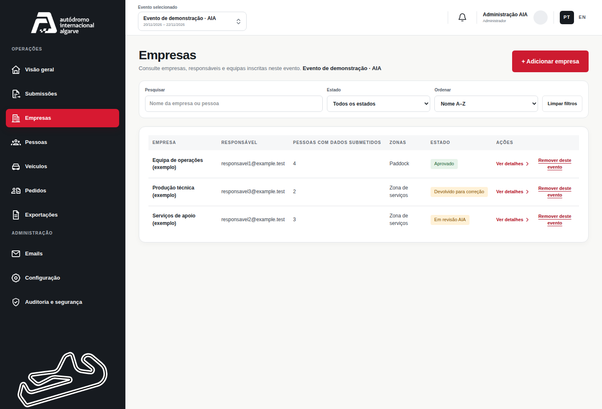
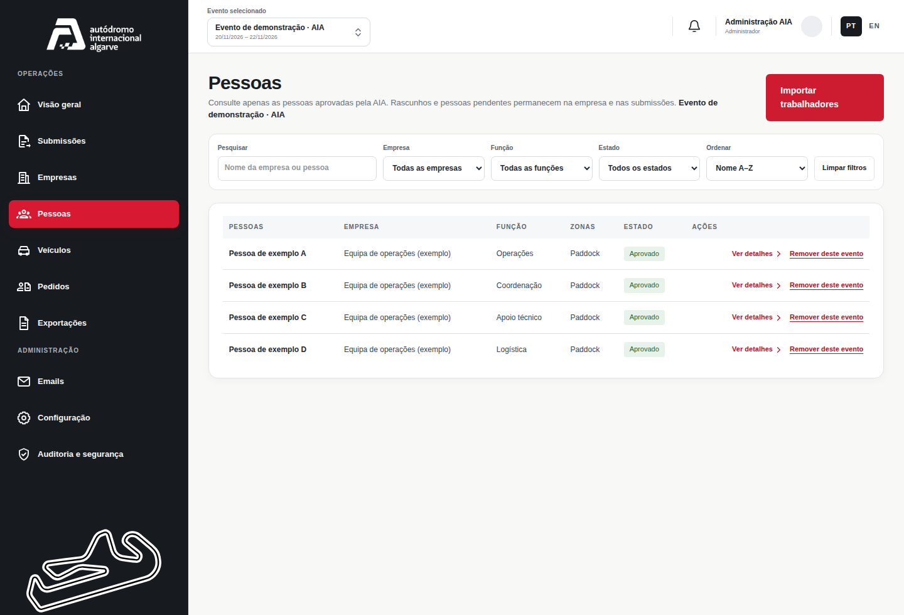
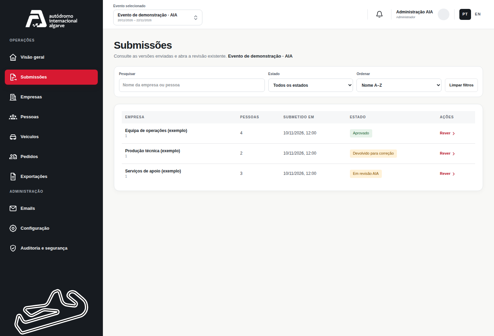
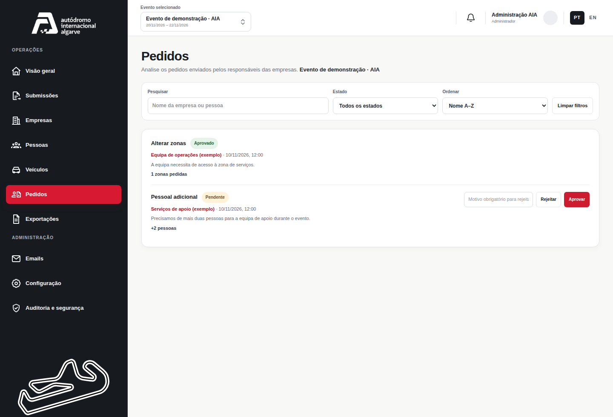
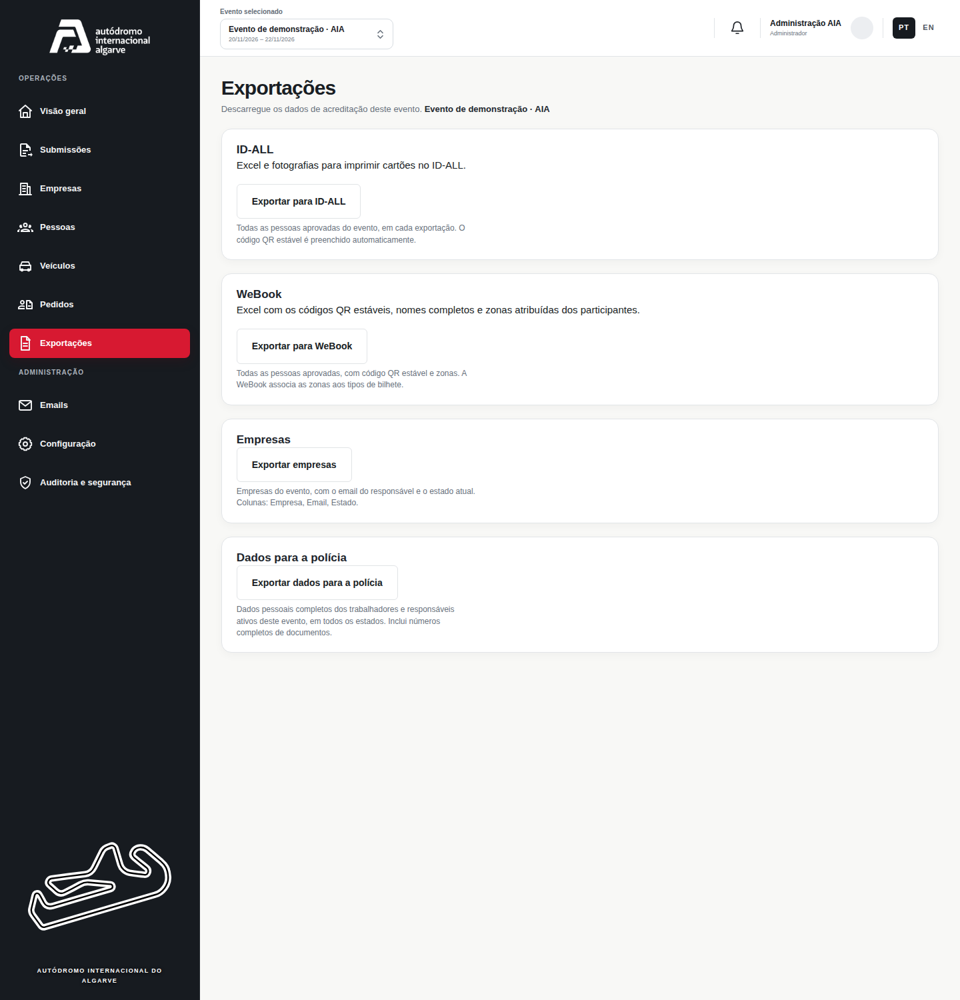

# AIA Acreditação

The accreditation portal for the **Autódromo Internacional do Algarve**. It brings together the companies working at an event, the people on their teams and the AIA staff who review their accreditation.

Companies submit their team details in one place. AIA reviews those submissions, handles changes and downloads the information needed for badge printing, access-system imports and event reporting.

**Portal:** [app.joinaia.pt](https://app.joinaia.pt) · **Languages:** Português / English · **Access:** by invitation and assigned role

This is a private operational application maintained for AIA. This repository contains its source code and internal documentation.

## Who uses it

| Person | What they do | Where |
| --- | --- | --- |
| **AIA administrator** | Sets up events, invites companies, reviews submissions, decides requests and downloads exports. | Administration area; choose the event at the top of the page. |
| **Company responsible contact** | Completes their own details, manages their company’s workers, submits the team for review and requests changes. | Company portal: **Os meus dados**, **Trabalhadores**, **Submissão final** and **Pedidos**. |
| **Worker** | Fills in their personal details and uploads a photograph when given an onboarding link. | The individual link supplied by the company responsible contact. |

A company responsible contact sees the companies they are authorised to manage. Each event has its own registration, personnel limit, dates and review status.

## From invitation to approval

1. **AIA prepares the event.** Set the event dates, registration deadline, access zones and available job roles. Add companies, set their personnel limits and invite their responsible contacts.
2. **The responsible contact prepares the team.** Complete **Os meus dados**, then use **Trabalhadores** to add workers. Details can be entered directly or collected through individual onboarding links.
3. **Workers’ details are checked.** The record includes name, birth date, document details and expiry, nationality, mobile number, job role, workdays, photograph and privacy acknowledgement. The responsible contact reviews the workers before final submission.
4. **The company submits to AIA.** **Submissão final** sends a version of the team details for review. Saving a worker’s details alone does not submit the company or grant AIA approval.
5. **AIA makes a decision.** Approve, return for corrections or reject. Previous submitted versions and review decisions remain in the history. Changes that need another review follow the appropriate request/submission process.

The screenshots below show the actual administration page components with **fictional demonstration data**, not live company or personal records. The interface is shown in Portuguese; English is also available.

## Companies: invitations, capacity and progress

Open **Administração → Empresas** after selecting an event. Find a company, check its status and personnel count, or open its details to inspect the team and responsible contacts. **Adicionar empresa** starts the company invitation process.

## People: the approved event list

Open **Administração → Pessoas** to see people whose company registration and worker approval qualify them for the approved list. Search and filter by company or role, then open a person’s record for more detail. People still being prepared or reviewed can be inspected through their company’s team.

## Submissions: AIA’s review queue

Open **Administração → Submissões** to find submitted companies and their review status. **Rever** opens the submitted version for review. AIA can approve it, return it for corrections with an explanation, or reject it.

| Status | What it means |
| --- | --- |
| **Rascunho** | The company’s details are still being prepared or updated. |
| **Em revisão AIA** | A submitted version is awaiting AIA’s decision. |
| **Devolvido para correção** | Corrections are needed before another submission. Some screens use **A aguardar correções**. |
| **Aprovado** | The company registration has been approved by AIA. |
| **Rejeitado** | AIA has rejected the registration. |

**Aprovado pelo responsável** is a worker-level status: the company responsible contact has reviewed that person. It is distinct from AIA approving the company’s submission.

## Requests: changes to an existing registration

Company contacts use **Pedidos** to request extra personnel capacity, late additions, replacements or changes to details, workdays, zones and vehicle passes. AIA handles these in **Administração → Pedidos**.

A request’s approval authorises that particular change. The company may still need to finish the change and submit the updated details. **Adicionar após o prazo** permits late additions within the authorised personnel limit; **Pessoal extra** requests an increase to that limit.

Moving only the registration closing deadline preserves existing approvals. Changes to other event review requirements can require a new review.

## Exports: choose the file for the job

Open **Administração → Exportações** with the correct event selected. These downloads are available to administrators.

| Export | Contents | Use |
| --- | --- | --- |
| **ID-ALL** | A ZIP containing the Excel workbook and processed photographs for eligible approved attendees. The workbook includes **EMPRESA** in column F. | Prepare badge printing in ID-ALL. |
| **WeBook** | An Excel workbook with stable QR values, full names and assigned zones for eligible approved attendees. | Import into WeBook; map zones to the relevant ticket types there. |
| **Empresas** | `Empresas.xlsx`, with exactly **Empresa · Email · Estado**. Includes active external company registrations across all statuses and the recorded responsible contact’s email. | Follow up with companies and report registration progress. |
| **Dados para a polícia** | `Policia.xlsx`, with **Trabalhadores** and **Responsáveis** sheets. Includes full recorded document numbers, names, dates of birth, document expiry, nationality, contact details, roles, workdays, requested zones and statuses. **No photographs.** | Prepare the requested personal-data report for the police. The portal downloads the file; it does not send it to the police. |

The police export includes active records at every status, not just approved attendees. Removed/replaced or erased people, withdrawn registrations and inactive companies are excluded. Information that was never entered remains blank. Document numbers are exported in full as text, preserving leading zeroes and long values.

ID-ALL and WeBook have a different purpose: they use the eligible approved set. Downloading a file does not approve people, change a registration or send an email. An export does not itself confirm that a badge has been printed or an external-system import has completed.

## Finding the right screen

| Task | Start here |
| --- | --- |
| Invite a company or inspect its team | **Administração → Empresas** |
| Check submitted versions and make an AIA decision | **Administração → Submissões** |
| Browse approved people and their zones | **Administração → Pessoas** |
| Decide a change request | **Administração → Pedidos** |
| Review vehicle-pass quantities and requests | **Administração → Veículos** |
| Change the event setup, dates, roles or zones | **Administração → Configuração** |
| Inspect recorded activity or email delivery status | **Auditoria e segurança** or **Emails** in administration |
| Add or correct the company’s workers | **Company portal → Trabalhadores** |
| Send the company’s team to AIA | **Company portal → Submissão final** |
| Download printing, access-system or reporting files | **Administração → Exportações** |

For an invitation, access problem or a correction to an existing registration, contact the AIA event administration team. An individual worker link and a company responsible-contact invitation serve different purposes; use the link supplied for your role.

## Technical documentation

The everyday portal workflow is described above. Installation, development and service operation are covered separately:

- [Local development](docs/LOCAL-DEVELOPMENT.md) — source editing, local services and the development workflow.
- [Authentication setup](docs/AUTH-SETUP.md) — Clerk configuration, accounts and invitation access.
- [Operations runbook](docs/OPERATIONS_RUNBOOK.md) — operational checks and service procedures.
- [Email monitoring](docs/EMAIL-MONITORING.md) — delivery visibility and investigation.
- [Architecture](docs/ARCHITECTURE.md), [domain rules](docs/DOMAIN-RULES.md) and [security](docs/SECURITY.md) — engineering background.
- [Screenshot provenance](docs/screenshots/README.md) — how these documentation images were prepared.

Local development and a live production release are separate workflows. A documentation or source-code push does not rebuild or deploy the running application. Historical phase documents describe earlier milestones; use the current code and reviewed release instructions when preparing an application update.
